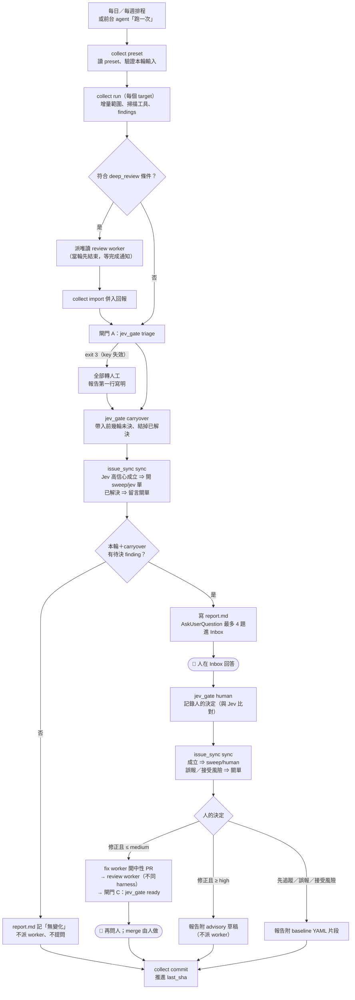
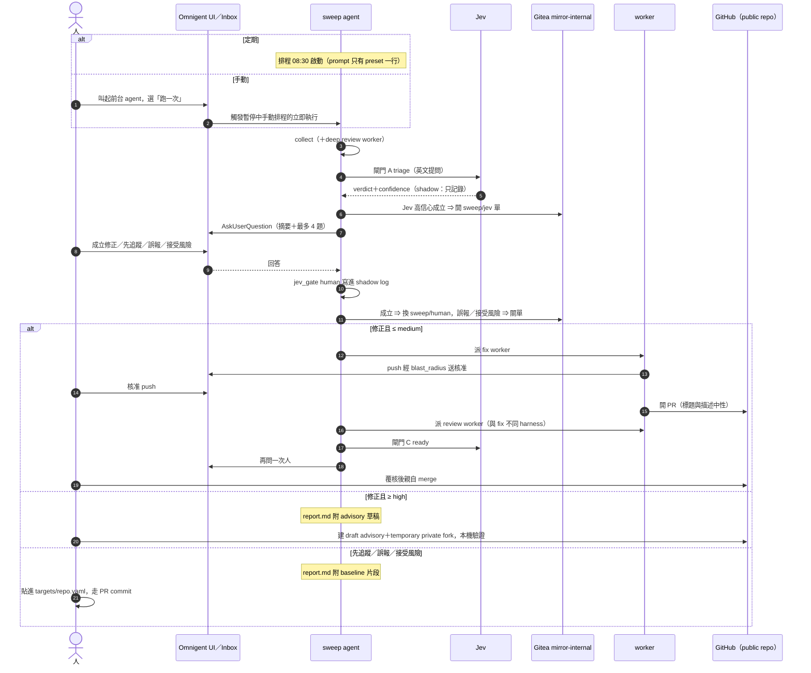

# woow-security-sweep

每日安全掃描與修正的 Omnigent bundle。**本檔給維護者看**，不進 agent 的 prompt（prompt 是
`AGENTS.md`）。設計討論與決策見 #1921。

```
woow-security-sweep/          claude-native／claude-sonnet-5-5[1m]／high／spawn: true
├── config.yaml               產物（build.py 產生，⛔ 不要手改）
├── build.py                  產生 config.yaml ＋ 7 項驗收（--check）
├── AGENTS.md                 leader prompt（手改）
├── gates.yaml                Jev model 版本、mode（shadow／enforce）、門檻
├── targets/<repo>.yaml       各 repo 的 private 上下文（⚠ 不可複製到 public repo）
├── skills/
│   ├── sec-collect/          scripts/collect.py：設定合併、增量範圍、掃描工具、findings
│   ├── sec-gate/             scripts/jev_gate.py：Jev 閘門、路由、shadow log、校準
│   ├── sec-dispatch/         用 woow-issue-leader/generate-worker.py 派 worker
│   ├── sec-issue/            scripts/issue_sync.py：成立的 finding 開到 Gitea mirror-internal（#1957）
│   └── sec-report/           report.md 與 Inbox 提問
└── tests/                    unittest（CI：.gitea/workflows/security-sweep-tests.yml）
```

## 流程

權威是 `AGENTS.md` §每輪流程；下面兩張圖是它的圖解，改流程時兩邊一起改。

### 運作流程

一輪 sweep 內部的步驟。圓角框（👤）是要等人的地方。



- `collect commit` 只看閘門 A 有沒有跑完，**不等人回答**；閘門 A 失敗的 target 不 commit，下輪重掃同一段。
- 人沒回答的題目不會遺失：完整內容在 `report.md`，下一輪由 carryover 再帶出來重問。

### 人類互動流程

誰在什麼時候碰到人。sweep 自己不對 GitHub 寫入、不 merge；人工關卡都在 Inbox 或 GitHub 上。



人工關卡一覽：

| 關卡 | 在哪裡 | 人做什麼 | 沒處理會怎樣 |
|---|---|---|---|
| 手動跑一次 | UI 叫起前台 agent | 選 preset、按「跑一次」 | 只跑定期排程 |
| 判斷 finding | Inbox（AskUserQuestion） | 成立修正／先追蹤／誤報／接受風險 | 下輪 carryover 再問；Jev 高信心的單已先開 |
| 本輪摘要（沒有待決時） | Inbox | 已閱，或要求 full 重掃 | 無影響 |
| 修正 PR 的 push | Inbox（blast_radius） | 核准 push | worker 停在 push 前 |
| 修正 PR 的 merge | GitHub | 看過覆核結論與閘門 C 後 merge | PR 一直開著；agent 不代 merge |
| high／critical 修正 | GitHub Security Advisory | 依報告草稿建 draft advisory 與 private fork，本機驗證 | 只留在報告的待辦 |
| baseline | 本 repo `targets/<repo>.yaml` | 貼上報告給的片段、開 PR | 該 finding 每輪仍會列在「已決未進 baseline」 |
| Phase 2 放開門檻 | `gates.yaml` | 改 mode、改測試、走 PR | 維持 shadow，一切由人決定 |

**Phase 1（shadow）**：`gates.yaml` 的 `mode: shadow` ⇒ 每筆 decision 的 `effective` 一律是
`human`。Jev 的 `proposed` 只拿來和人的決定比對。`tests/test_jev_gate.py` 有一條測試鎖住
committed 的 mode 必須是 shadow——改成 enforce 要人拍板、改測試、走 PR。

**Phase 2**：`jev_gate.py calibrate` 每個閘門 ≥ 50 筆後，依信心區間的一致率逐項放開
（先放「丟誤報」與「開 draft PR」）。

## issue（#1957）

成立的 finding 由 `issue_sync.py` 開到 **Gitea `mirror-internal/<repo>`**（org 為 limited，匿名看不到）。
⛔ 不開在 GitHub：目標 repo 是 public。開單條件、label 與去重見 `skills/sec-issue/SKILL.md`；
`gates.yaml` 的 `issues` 區塊控制開關與 Jev 門檻（`jev_min_confidence`，起始 0.85）。

| label | 意思 |
|---|---|
| `woow-security-sweep` | 由 sweep 開的單（篩選用） |
| `sweep/human` | 人在 Inbox 判成立 |
| `sweep/jev` | Jev 高信心判成立，還沒經人確認 |
| `sweep/false-positive` | 人判誤報或接受風險，sweep 已關單 |
| `severity/<level>` | 嚴重度（Jev 與工具取高者） |

寫入走 runner 上的 `tea` 登入（`issues.tea_login`），以登入者身分開單；換主機要先 `tea login`。

## 設定的兩層

| 位置 | 內容 | 可見度 |
|---|---|---|
| 目標 repo 的 `.security/sweep.yaml` | `scan`、`always_human`、`autofix`、`verify` | public；**只讀 origin 預設分支** |
| 本目錄 `targets/<repo 目錄名>.yaml` | `context`、`review_focus`、`history`、`baseline`、`disclosure` | private（本 repo） |

collect.py 只從 private 檔取上面五個 key，private 不能放寬 public 的規則。repo 沒有
`.security/sweep.yaml` ⇒ 保守預設（不自動修、high 以上轉人工）。`.security/` 有任何變動 ⇒
自動產生 `security-config-changed` finding、必轉人工（防止有人在 PR 裡偷加豁免）。

## Jev（TypeSafe System One）

- API：`POST https://api.typesafe.ai/v1/systemone`，Bearer 認證；題型 choice／score／noul
- key：`~/.config/typesafe/api_key`（`chmod 600`），**只有 jev_gate.py 讀**；可用
  `TYPESAFE_API_KEY_FILE` 覆寫路徑。leader 的 `p_secret_no_api_key_read` 擋讀取
- `gates.yaml` 釘版本號（`jev-1.13.0`），⛔ 不用 `jev-latest`：alias 換版後答案會變、門檻失效。
  換版要重跑 calibrate
- 問題一律英文：官方文件註明 CJK 準確度較差
- 冒煙測試：`python3.12 skills/sec-gate/scripts/jev_gate.py models`

## 上線步驟

bundle 不綁主機：`<WS>` 是排程的 workspace，agent 開工時由 `$OMNIGENT_RUNNER_WORKSPACE` 取得（#1934）。

| 主機 | host_id | `<WS>` |
|---|---|---|
| UbuntuServer-59mqj | `88ca3ca80a434609a3ed3a35d7bac513` | `/home/elmo/woow-repos` |
| Pi Web ChatGPT (pi3) | `f3cb408633ad4ddabcbabec0401c41d6` | `/data/pi-agent/home/woow-repos` |

安裝、檢查、發新版一律走 setup skill（`.agents/skills/woow-security-sweep-setup`，#1978）；
跑一次、建排程、查狀態走 launch skill（`.agents/skills/woow-security-sweep-launch`），或從 UI 叫起
前台 agent（`.omnigent/woow-security-sweep-launcher`）。四者關係見 `.omnigent/README.md`
§woow-security-sweep 整體關係。

1. 更新該主機的主 checkout：`<WS>/paas/woow_paas_platform` 切到最新 develop
   （AGENTS.md 與 skills 用這個路徑呼叫腳本）
2. `setup.py --workspace <WS> doctor --check-api`：環境（python3.12、gitleaks、uvx、tea、Jev key）、
   targets、tea 對 mirror-internal 的寫入權限、主機擁有者、既有排程，全部由腳本判斷。
   state（`<WS>/.omnigent-runtime/woow-security-sweep`）換主機要整個搬過去，否則人工決定與 carryover 會遺失
3. 註冊或接手 agent：照 setup skill §2（自己註冊或接手共用的 anchor），完成後 `record-agent`
   記下 anchor 與 agent_id（`<state>/agent.json`）。⛔ 改版不要再 `sys_session_create` 重新上傳
   （會換 agent_id），改走 setup skill §3 的 `bundle-plan`／`bundle-apply` 原地更新
4. 註冊前台 agent（setup skill §2：在 `<WS>` 執行一次 `omnigent run …/woow-security-sweep-launcher`，
   再 `record-agent --agent launcher`），再跑一次 doctor，`ready: true` 才建排程
5. 建排程：一律用 launch skill 的 `launch.py schedule`（同一天 targets 重疊會拒絕、補設 `max_cost_usd`、
   讀回逐欄核對）。定期排程用 `--rrule`，另為每個 preset 建一個 `--manual` 手動排程（暫停中，
   「跑一次」觸發它的立即執行）。腳本寫入的欄位：

   | 欄位 | 值 |
   |---|---|
   | `agent_id` | `<state>/agent.json` 的 `agent_id`（原地更新不會換） |
   | `rrule` | 每日 `FREQ=WEEKLY;BYDAY=TU,WE,TH,FR,SA,SU;BYHOUR=8;BYMINUTE=30`；每週 `FREQ=WEEKLY;BYDAY=MO;BYHOUR=8;BYMINUTE=30`；手動排程固定一年一次並暫停 |
   | `timezone` | `Asia/Taipei` |
   | `workspace` | 該主機的 `<WS>` |
   | `host_id` | 該主機的 host_id（有給 workspace 就必填，否則 400） |
   | `permission_mode` | `auto` |
   | `max_cost_usd` | `30`（`--max-cost`；config 另有 60 USD 硬上限） |
   | `prompt` | `preset: line-daily`／`preset: line-weekly`（只有這一行） |

   preset 用 setup skill 建立（`setup.py preset`），內容存在 `<state>/presets/<名稱>.yaml`：

   ```yaml
   targets:
     - <WS>/WOOW/woow_line_base
     - <WS>/WOOW/Woow_odoo_line_liff
     - <WS>/WOOW/woow_odoo_livechat_line
   mode: incremental        # 每週：full
   deep_review: auto        # 每週：always
   roster: {review: claude-native, fix: pi}
   ```

   ⛔ 不要把上面的 YAML 直接當排程 prompt：Omnigent 0.16.0 會把長 prompt 收合成 `[Pasted text]`，
   偵測不到草稿就只盲按一次 Enter，訊息停在輸入框不送出，run 紀錄卻寫 `succeeded`（#1989）。
   setup skill 的 doctor 會檢查 prompt 長度與最近一次觸發是否真的開始執行。

   週一只跑每週那支（全量），避免兩支排程同時推進同一份 state。「跑一次」同理：targets 重疊的輪次
   還在進行（執行中、Inbox 有待答題目、或 6 小時內有活動但還沒 commit）就拒絕觸發。

## 已知限制與風險

| 項目 | 狀態 |
|---|---|
| worker 不繼承 `p_secret_no_api_key_read`／`p_forge_no_public_write` | 守線由 generate-worker.py 決定；目前靠工單紀律。fix worker 處理的是不可信的 repo 內容，Phase 2 前應把這兩條加進產生器 |
| CEL 守線是字串比對 | glob（`cat ~/.config/t*/a*`）等寫法擋不住；best-effort |
| AskUserQuestion 在排程 session 的等待上限 | 未實測。report.md 是完整紀錄，Inbox 項目消失也不遺失資料；第一次上線要確認 |
| gitleaks | runner 未安裝 ⇒ `tools.json` 標 `unavailable`；semgrep `p/secrets` 部分涵蓋 |
| pip-audit | 套件未釘版本 ⇒ 標 `skipped`；要掃得改在 Odoo image 層 |
| fix 用 claude-native | 需 #1729 合併；之前產生器只接受 implement + pi |
| symlink 逃逸 | 快照階段已擋並產生 high finding；fixer 在真 worktree 裡的路徑檢查仍是字串比對（見 #1729） |
| high／critical 的 private fork | Phase 1 只產 advisory 草稿，建立 advisory 與 private fork 由人操作 |
