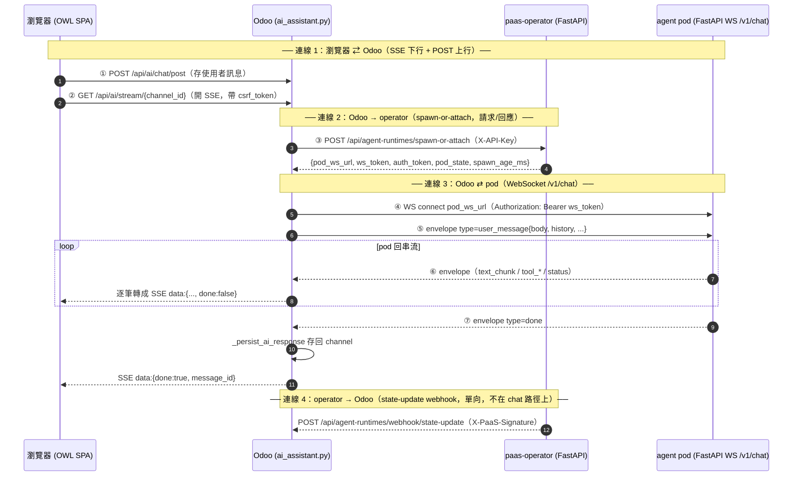

# /woow AI Chat（agent-runtime）資料流與 Secret 關係

> 這份文件給接手 agent-runtime 的工程師，說明 `/woow` AI chat 的資料流，以及各 secret / 參數彼此的關係。讀完你應該能回答：「一句使用者訊息從瀏覽器到 LLM agent pod，中間經過哪幾段連線、各用什麼認證、哪個 secret 沒設會壞哪一段」。
>
> 想看更細的子題（WS envelope 15 種 type、Pod 內部、skill bundle JWT）請接續讀 [`paas-skill-system/`](../paas-skill-system/README.md) 知識庫；本篇是**橋接全貌 + secret 關係**的鳥瞰圖。

---

## 0. 一句話心智模型：兩跳橋接（two-hop bridge）

`/woow` 的 AI chat **不是一條連線**。Odoo 是中間的**橋（bridge）**，兩跳用的協定不同：

- **瀏覽器（OWL SPA）⇄ Odoo**：用 **SSE**（Server-Sent Events / `EventSource`），**不是 WebSocket**。送訊息是另一條獨立的 `POST`。
- **Odoo ⇄ agent pod**：用 **WebSocket**。

Odoo 把 pod 的 WebSocket 串流，**逐筆轉成 SSE chunk** 再吐回瀏覽器。前端只看得到 SSE 那一層，所以「LLM 跑在 Odoo 內」與「LLM 跑在 per-project pod」對瀏覽器是無感的（同一條 `GET /api/ai/stream/...`）。



> ⚠️ 連線 4 是**狀態同步**，不在 chat 的來回路徑上。operator **已接線**（每次 spawn-or-attach + reap 經 `BackgroundTask` POST state-update webhook，見 [§5](#5-目前現況--已知缺口)），但因為它跑在 chat 來回路徑之外（response 送出後才觸發、no-op/失敗都不 raise），**斷了也不會讓 chat 壞**。

---

## 1. Chat 資料流（程式碼對應）

落點集中在 `src/controllers/ai_assistant.py`（agent-runtime 分支）與 `src/services/agent_runtime_client.py`（呼叫 operator）。

### 1.1 送訊息（上行）— 一條獨立的 POST

- `POST /api/ai/chat/post`（`type='json'`、`auth='user'`）— `src/controllers/ai_assistant.py:343`
- 它只做一件事：把使用者訊息 `message_post` 進 `discuss.channel`（觸發 mail.message 落地），**不負責產生回覆**。回覆走另一條 SSE。

### 1.2 收回覆（下行）— SSE 串流

- `GET /api/ai/stream/<int:channel_id>`（`type='http'`、`auth='user'`）— `src/controllers/ai_assistant.py:488`
- 因為是 GET，Odoo 不自動驗 CSRF，所以這裡**手動驗 `csrf_token`**（`ai_assistant.py:502-504`）。
- 回傳 `Response(generate(), content_type='text/event-stream')`，並帶三個關鍵 header（`ai_assistant.py:938-946`）：

  | Header | 作用 |
  |---|---|
  | `Cache-Control: no-cache` | 不要快取串流 |
  | `Connection: keep-alive` | 維持長連線 |
  | `X-Accel-Buffering: no` | **告訴 nginx 不要 buffer 這條串流**（否則 chunk 會被攢起來不即時吐） |

### 1.3 dual-mode gate：legacy vs agent-runtime

進到 `api_ai_stream` 後，用 `channel → project.task → project.use_agent_runtime` 判斷走哪條路（`ai_assistant.py:516-524`）：

- `use_agent_runtime == False`（**預設**）→ legacy：LLM 跑在 Odoo 內（`AIClient` / LangChain），不在本篇範圍。
- `use_agent_runtime == True`（pilot 開啟）→ `self._stream_agent_runtime(...)`（`ai_assistant.py:716`），即本篇主角。

### 1.4 `_stream_agent_runtime`：橋接 pod 的那段（`ai_assistant.py:716`）

進入串流前（cursor 還有效時）先備齊 ORM 資料，再進 `generate()` generator：

1. `_check_project_access` project 存取檢查（`ai_assistant.py:726`）。
2. `_resolve_agent_template(project)` 解析要用哪個 agent 範本（順序：project 綁定的 published → project 綁定的任意 → `project.agent_template_id` → 平台預設）。
3. `_build_mcp_snapshot` / `_build_skill_snapshot` 組 MCP 與 skill 快照。

   > 🧩 **single source（#111 refactor，2026-06-02）**：`_platform_default_agent_template` / `_resolve_agent_template` / `_build_mcp_snapshot` / `_build_skill_snapshot` 這四個方法已**下沉到 `woow_paas_platform.agent_session` model**（`@api.model`），讓 chat（controller）與 on-publish 推送（§4.5）**共用同一份 snapshot/resolve 邏輯**。controller `ai_assistant.py` 的同名方法現在是 thin delegate（行為等價，呼叫 `request.env['woow_paas_platform.agent_session']._resolve_agent_template(...)` 等）。
4. **組 per-turn system_context**（spawn 之前、cursor 仍有效時預取）：

   - **system_context（per-turn）**：`agent_session._build_runtime_system_context()`
     把 `agent_template.system_prompt` + 統一背景 context（Project / Task /
     Cloud Services 白名單，見 spec 2026-06-04-agent-context-enrichment）組成
     單一字串，放進 `user_message.payload.system_context`（additive；空值省略
     key）。pod 端原樣 `SystemMessage(content=...)`，不驗內容、零 truncation —
     長度由 Odoo 端 `CTX_TOTAL_CAP=8000` 把關。
5. `client.spawn_or_attach(...)` 呼叫 operator 把 pod 起來 / 接上（`ai_assistant.py:762`）。
6. **從回應物件**讀 pod 位址：`pod_ws_url = runtime_info.get('pod_ws_url')`（`ai_assistant.py:782`）。

   > 🔑 **關鍵**：pod 的 WS 位址來自**這次 spawn 的即時回應**，**不是**讀任何 DB 欄位（不是 `agent_session.pod_ws_url`）。這正是為什麼 [§5](#5-目前現況--已知缺口) 的 `agent_session.state` 卡死也不影響 chat。
7. `auth_token = runtime_info.get('auth_token') or runtime_info.get('ws_token')`（`ai_assistant.py:783`）— 對 operator 回的兩個等值欄位都相容。
8. 連上 pod（`websockets.connect(pod_ws_url, extra_headers={'Authorization': f'Bearer {auth_token}'})`），先送一筆 `user_message` envelope（payload 含 `system_context`），再 `async for` 把 pod 回來的 envelope 逐筆轉成 SSE。

   > 🔁 **cold-start WS connect bounded retry（#123 / F-ARL-1 / pitfall G3，2026-06-02）**：cold-start 時 `spawn_or_attach` 可能回 `pod_state="spawning"`，pod 還沒 WS-ready，第一次 connect 會 `ConnectionRefusedError`。`relay()` 現在把 **connect** 包進退避重試迴圈（backoff `1→2→…→5s`，deadline **60s**）：connect 失敗就推一筆 `status:spawning` 進度 event（前端轉黃色「AI 啟動中…」非紅錯誤）後重試；逾 deadline 才送 fatal `error`。**retry 只包 connect**（連上後的 `send(user_message)` + drain loop 不在 retry 範圍）→ mid-stream 斷線**絕不重送 `user_message`**。connect 成功後仍走 `try/finally` 的 `cm.__aexit__(...)`，保留 §1.5 的 F-PC-6 aclose 清理語意。配套 client 側（`agent_runtime_client.py`）：`spawn_or_attach` 對 idempotent spawn 做 bounded retry（transient timeout/connection 重試、4xx 不 retry）+ per-call timeout 分級（spawn 90s / invalidate 10s / 其餘 default 30s）。

### 1.5 envelope → SSE 對照（`ai_assistant.py:865-913`）

| pod envelope `type` | Odoo 動作 | 吐給瀏覽器的 SSE |
|---|---|---|
| `text_chunk` | 累加 `payload.content` | `data:{chunk, done:false}` |
| `tool_call` / `tool_result` / `tool_error` / `tool_unavailable` / `status` | 原樣轉發 | `data:{...envelope, done:false}` |
| `done` | `_persist_ai_response()` 把完整回覆存回 channel | `data:{chunk:'', done:true, full_response, message_id?}` |
| `error` | 結束串流 | `data:{error, done:true}` |

> 收尾陷阱：`done` / `error` 跳出 drain loop 時，relay generator 還掛在 `async with websockets.connect()` 裡，必須 `agen.aclose()` 才會觸發 WS 關閉，否則**每輪對話漏一條 pod 連線**（`ai_assistant.py:921-936`，F-PC-6 / P-2）。

### 1.6 pod 端（不在本 repo）

pod 是一支 FastAPI WebSocket endpoint `/v1/chat`，程式碼在獨立的 `paas-agent-runtime` repo（**不要在本 repo 找**）。它收下 `user_message` envelope + context，跑 LLM/agent loop，再把回覆串流回來。本 repo 只負責「橋」這一側。

---

## 2. spawn-or-attach（連線 2 的請求/回應）

### 2.1 Odoo 這側：`agent_runtime_client.py`

- `AgentRuntimeClient.spawn_or_attach(...)`（`src/services/agent_runtime_client.py:117`）→ `POST /api/agent-runtimes/spawn-or-attach`，用 **operator API key** 認證（header `X-API-Key`，`agent_runtime_client.py:93-98`）。
- client 由 `get_agent_runtime_client(env)` 建立（`agent_runtime_client.py:202`），它從 `ir.config_parameter` 讀 `woow_paas_platform.operator_url` + `woow_paas_platform.operator_api_key`；任一沒設就回 `None`（fail-closed）。
- `_project_hash(project)`（`agent_runtime_client.py:193`）：解析（或建立）該 project 的 `agent_session` row，回傳 `project_namespace_hash`，當作 request body 的 `project_hash`。

### 2.2 operator 這側：`extra/paas-operator/src/api/agent_runtimes.py`

handler `spawn_or_attach`（`extra/paas-operator/src/api/agent_runtimes.py:339`）：

- **cold start**（release 不存在）：建好帶 `paas-managed=true` label 的 namespace → 確保 registry pull secret → provision per-tenant LLM secret → `jwt_signer.sign_skill_bundle_token(...)` → `helm_service.install(... chart=agent-runtime, **_chart_source_kwargs())`（`agent_runtimes.py:349-367`），`pod_state = "spawning"`。
- **attach / resume**（release 已存在）：重用既有 pod；replicas==0 時 resume（重簽 token + scale 1），否則 attach（不重裝），`pod_state = "active"`（`agent_runtimes.py:387-405`）。
- 最後 `jwt_signer.sign_ws_token(...)` 簽 WS token 並回傳（`agent_runtimes.py:440-473`）：

  ```text
  {pod_ws_url, ws_token, auth_token, pod_state, spawn_age_ms}
  ```

  注意：`ws_token` 與 `auth_token` **是同一個值**（`agent_runtimes.py:469-470`，`auth_token` 是相容別名）。`pod_state` 只會是 `"spawning"`（cold）或 `"active"`（attach/resume）。

> 與 [`paas-skill-system/02-conversation-streaming.md`](../paas-skill-system/02-conversation-streaming.md) 的小差異：那篇把回應寫成 `{pod_ws_url, auth_token, pod_state, spawn_age_ms}`（省略 `ws_token`），實際 operator 兩個都回；Odoo 端 `ai_assistant.py:783` 也兩個都吃，行為一致。

---

## 3. 每個 project 怎麼拿到「自己的」pod — namespace 推導

這是理解「單一共用 secret 怎麼做到 per-project 隔離」的核心。

- 推導函式 `_compute_project_namespace_hash(project_id, secret)`（`src/models/agent_session.py:25`）：

  ```text
  hash = base32( HMAC_SHA256(project_id, NAMESPACE_SECRET)[:10] )  → 16 個小寫字元
  ```

- operator 用這個 hash 拼出 K8s 名稱（`extra/paas-operator/src/api/agent_runtimes.py:51-66`）：

  | 名稱 | 樣板 | 預設 prefix（`paas-ws-`） | stg（`paas-ws-stg-`） |
  |---|---|---|---|
  | namespace | `{namespace_prefix}pa-{hash}` | `paas-ws-pa-<hash>` | `paas-ws-stg-pa-<hash>` |
  | helm release | `agent-pa-{hash}`（與 prefix 無關） | `agent-pa-<hash>` | `agent-pa-<hash>` |
  | pod WS URL | `ws://{release}-svc.{namespace}.svc.cluster.local:8000/v1/chat` | — | — |

  `namespace_prefix` 來自 operator 設定 `settings.namespace_prefix`（預設 `"paas-ws-"`，`extra/paas-operator/src/config.py:19`；stg 環境 env-scoped 成 `paas-ws-stg-`）。

> 🔑 **為什麼一把共用 key 能讓每個 project 有獨立 pod**：key 相同，但 `project_id` 這個輸入不同 → HMAC 出不同 hash → 不同 namespace / release / pod。**隔離來自「輸入不同」，不是「key 不同」。**

### 3.1 並發分層：pod 是 per-project 共用，Odoo worker 是 per 串流連線

「SSE 每對話佔 1 worker」常被誤讀成「每個人 / 每個 task 一個 pod」。兩件事在不同層，**容量要分開計算**：

| 層 | 單位 | 隨什麼成長 | 同一 task 兩人同時對話 |
|---|---|---|---|
| agent pod（K8s） | **1 project = 1 pod**，該 project 下所有 task、所有人（internal + portal）共用；pod 內部用 LangGraph `thread_id = channel_id`（per-task channel）區隔每條對話串的記憶 | project 數 | 同一個 pod |
| Odoo HTTP worker | **1 條開著的 SSE（`GET /api/ai/stream/...`）= 佔 1 個 worker**，直到該次串流結束 | 同時收串流的連線數 | 2 個 worker |

```text
瀏覽器 A ──SSE──▶ ┐
                   Odoo（每條 SSE 佔 1 個 HTTP worker）──WS──▶ agent pod（per-project 共用 1 個）
瀏覽器 B ──SSE──▶ ┘
```

- **pod 數不隨人數 / task 數成長**（per-user → per-project 是 epic 中已拍板的 pivot）。
- **同時串流人數**的上限受 Odoo worker 數限制（design doc 既有約束：100 active 對話 = 100 worker slot，`docs/plans/2026-Q2/agent-runtime-pod-design.md:129`）；對外開放（如 portal task 頁 chat）時要看的是這個維度，**不是** pod 資源。
- 量大時的演進路徑是瀏覽器側改 bus WebSocket 推播（整則訊息、非逐字），釋放 worker——見 `docs/superpowers/specs/2026-06-05-portal-task-agent-chat-design.md` 的風險節。

---

## 4. 狀態同步（state-sync / 「stats」）機制 — 設計 §5.5

`agent_session` 這張表是用來**追蹤每個 project pod 的生命週期狀態**（給後台觀測用），與 chat 路徑解耦。

### 4.1 Model：`woow_paas_platform.agent_session`（`src/models/agent_session.py`）

- 一個 project 一列（`UNIQUE(project_id)`，`agent_session.py:165-176`）。
- 關鍵欄位：

  | 欄位 | 說明 |
  |---|---|
  | `state` | selection：`absent` / `spawning` / `active` / `reaped` / `degraded` / `spawn_failed`，**預設 `absent`**（`agent_session.py:113-124`） |
  | `project_namespace_hash` | §3 推導出的 hash（`agent_session.py:104`） |
  | `pod_ws_url` | pod WS 位址（觀測用；**chat 不讀它**，見 §1.4） |
  | `last_synced_at` | 最後一次被 webhook / drift cron 同步的時間（`agent_session.py:156`） |
  | `last_state_event_ts` | operator 最後一次 state event 的時戳（`agent_session.py:160`） |
  | `spawn_at` / `last_active` / `reaped_since` | 生命週期時間點（`agent_session.py:147-149`） |

- `NAMESPACE_SECRET` 採 **fail-closed**：`_get_namespace_secret()` 讀不到 env 就 raise（`agent_session.py:230-246`），不退回任何「原始碼可推得」的預設值（否則任何看到原始碼的人都能算出 namespace hash）。

### 4.2 入站 webhook（主要管道）：`agent_runtime_webhook.py`

- `POST /api/agent-runtimes/webhook/state-update`（`type='http'`、`auth='none'`、`csrf=False`）— `src/controllers/agent_runtime_webhook.py:74-79`。
- 用 HMAC-SHA256 驗 `X-PaaS-Signature`，採**雙 secret**（current 或 previous 任一通過即可，支援輪替重疊，`agent_runtime_webhook.py:45-57`）：
  - 現用：`AGENT_RUNTIME_WEBHOOK_SECRET`
  - 輪替舊鑰：`AGENT_RUNTIME_WEBHOOK_SECRET_PREVIOUS`
- 驗章通過後，用 payload 的 `project_hash` 找到對應 `agent_session`，寫入 `state` + `last_synced_at` + `last_state_event_ts`（+ 可選 `pod_ws_url`）（`agent_runtime_webhook.py:92-107`）。
- 失敗碼：簽章錯/缺 → **401**；hash 找不到對應 session → **404**。

### 4.3 出站 dispatcher（operator 這側）：`webhook_dispatcher.py`

- `dispatch_state_update(odoo_base_url, payload, secret)`（`extra/paas-operator/src/services/webhook_dispatcher.py:29`）：HMAC 簽 body（header `X-PaaS-Signature: sha256=<hex>`）→ POST 到 Odoo receiver，5xx 重試 3 次 exponential backoff。

### 4.4 後備拉取（fallback pull）：drift cron

- `_cron_drift_detection`（`src/models/agent_session.py:249`），cron 定義在 `src/data/agent_session_cron.xml`（每 5 分鐘）。
- 它重新同步「state ∈ `['spawning','active','reaped','degraded']` 且 `last_synced_at` 過舊（> 10 分鐘）」的 session，做法是反向呼叫 operator 的 `get_status`（`agent_session.py:259-281`）。
- ⚠️ **它刻意排除 `'absent'`**（`agent_session.py:261`）。這點與 §5 的現況缺口直接相關。

### 4.5 skill / mcp on-publish 即時推送（#111）

平常 pod 是在下一次 chat 的 `spawn_or_attach`（attach 路徑）才刷新到最新 skill/mcp 快照。#111 補一條**發布即推**（best-effort）的捷徑：admin 一發布 skill / 改 MCP server，就把最新快照主動推給**正在跑的** pod，不用等下一次對話。

```text
skill.write(state 變動)         ┐
mcp_server.write(name/url/transport 變動) ┘
   → agent_session._push_snapshot_to_running_pods(kind, scope, project_id)
       → 列舉 state='active' 的 agent_session
           · scope='system' → 所有 active session（跨 project）
           · scope='user'   → 只該 project_id 的 session
       → 對每筆：_resolve_agent_template(project) → _build_skill_snapshot / _build_mcp_snapshot（§1.4 共用方法）
       → client.invalidate_skills(project_hash, snapshot)  （kind='skill'）
         client.invalidate_mcp(project_hash, snapshot)     （kind='mcp'）
```

- **觸發點**：
  - `skill.write` 的 `state` 變動分支（publish / deprecate / archive）→ 推 `kind='skill'`（`src/models/skill.py`）。`_recompute_is_latest` 內部只寫 `is_latest`（不含 `state`）故不重入、不遞迴。
  - `mcp_server.write` 變動到 **snapshot 欄位**（`name` / `url` / `transport`）才推 `kind='mcp'`（`src/models/mcp_server.py`）。`active` / `state` / `state_message` / tool 變動**不改** `_build_mcp_snapshot` 的輸出（它只序列化 server 的 name/url/transport）→ **不觸發**；**`mcp_tool` 同理不在 snapshot 內，不觸發**（避免無謂推送）。
- **best-effort 紀律**（沿用 §4.4 drift cron 範式）：`get_agent_runtime_client(env)` 回 `None`（operator 未設定）→ 整個推送 no-op；只推 `state='active'`（`spawning` 的 cold-start 本來就會帶到最新快照、`reaped`/`absent` 沒 pod）；**逐筆 try/except，單一 pod 失敗只 log warning 後 continue，絕不中斷發布**。推送失敗的 fallback 是下一次 chat 的 attach 刷新（ConfigMap kubelet 傳播本來就是「best-effort instant」）。
- client 側 `invalidate_skills` / `invalidate_mcp` 用短 timeout（10s，§1.4 timeout 分級）避免 hang 住發布交易。

---

## 5. 目前現況 / 已知缺口

> 本節嚴格區分「設計（本來該怎麼運作）」與「目前實際狀況」。以下皆為查證後的事實。

### 5.1 缺口：operator→Odoo 的 state-update webhook **程式碼已接線，剩環境 secret 待確認**

- 查證：operator 已有 **production caller** —— `notify_state_update`（內部包 `dispatch_state_update`）在**每次** spawn-or-attach 與 reap 都經 `BackgroundTask` 觸發（`extra/paas-operator/src/api/agent_runtimes.py:460-466` spawn-or-attach、`:496-501` reap，commit `a907743`）。spawn-or-attach 是**刻意每次都送**（含純 attach 穩態，非只在 cold-start/resume 轉移）——這是 self-heal 機制：Odoo `agent_session` row 在請求中才建（`state='absent'`、可能尚未 commit），加上 §4.4 drift cron 刻意跳過 `'absent'`，靠「每次 attach 都 re-notify」讓該列在下一輪 chat 收斂到 `active`（caller 註解明文標註「Do NOT optimize to transition-only」）。
- **剩餘缺口**：只在於 `AGENT_RUNTIME_WEBHOOK_SECRET` / `_PREVIOUS` 是否已**佈署到 stg / prod 環境**。這是 runtime 佈署問題（secret 落在 operator 自己的佈署側、由 Fleet 管理，**repo 內查不到**），須到對應環境確認；secret 若未注入，`notify_state_update` 會 no-op（不送 webhook，也不 raise）。
- **淨效果（secret 未佈署時）**：operator 不送 state-update webhook，所以 `agent_session.state` **可能停在建立時的預設 `absent`**，即使 pod 其實是健康執行中的；再加上 §4.4 的 drift cron 刻意跳過 `'absent'`，這列就**不會自我修復**。secret 一旦佈署，§4 這條 loop 即接通、self-heal 生效。

### 5.2 重要：這**不影響 chat**

- chat 能動，是因為它用的是**即時的 `spawn_or_attach` 回應**（`pod_ws_url` + `ws_token`，§1.4 / §2），**從不讀** `agent_session.state` 或 `agent_session.pod_ws_url`。
- 另查證：本 addon **沒有**任何 reap cron / billing / quota 邏輯讀 `agent_session.state` 來做決策（pod 的回收 reap 是 operator / k8s 側負責，`agent_runtime_client.reap()` 只是 POST 給 operator，不依賴 DB state）。
- **所以**：`state` 卡在 `absent` 目前的影響**純粹是可觀測性 / 正確性**（後台看到的狀態與真實不符），不是功能性故障。

### 5.3 對照連結

- 修復計畫（把 §4 這條 loop 接起來）：[`docs/superpowers/plans/2026-06-01-agent-runtime-state-sync-webhook.md`](../../superpowers/plans/2026-06-01-agent-runtime-state-sync-webhook.md)
- 同家族 pitfall（stg 啟用的 5 層 fail-closed gap chain）：[`docs/tracking/pitfalls/agent-runtime-stg-enablement-gap-chain.md`](../../tracking/pitfalls/agent-runtime-stg-enablement-gap-chain.md)

---

## 6. Secret / 參數對照表（本篇的重點）

> 只列**名稱與角色**，不列任何實際值。

| 參數 | 是什麼 | 誰用 | 把守（gate） | 沒設會怎樣 |
|---|---|---|---|---|
| `AGENT_RUNTIME_AUTH_SECRET_CURRENT`（HS256，輪替時加 `_PREVIOUS`） | 單一共用 HMAC-SHA256 key，**三方同值**（operator + 每個 agent pod + Odoo） | operator 用它簽 `ws_token` + `skill_bundle_token`；pod 驗章；Odoo 也用它 | chat 的 WebSocket（`ws_token`）+ pod 回 Odoo 抓自己的 skill bundle（`skill_bundle_token`） | 401 → chat / pod 不可用 |
| `AGENT_RUNTIME_NAMESPACE_SECRET` | 單一 HMAC key，用來**推導**每個 project 的 namespace hash | 只有 Odoo 用 | 定位 / 命名 per-project pod 的 namespace | Odoo fail-closed（"namespace secret not configured"）→ 無法定位 / 起 pod。**刻意單一、無輪替**：換 key 會改 hash → orphan pod |
| agent-runtime chart repo 拉取 token（operator 設定 `agent_runtime_repo_username` / `agent_runtime_repo_password`） | 一個 Gitea read:package token | 只有 operator 用（`helm install --repo <gitea> --username --password`） | 下載 **agent-runtime Helm chart** 來起 pod（**不是** image pull secret；image 拉取是另一個 registry secret `paas-registry`） | operator 抓不到 chart → 無法起 pod |
| `AGENT_RUNTIME_WEBHOOK_SECRET`（+ `_PREVIOUS`） | 共用 HMAC key，只在 **operator ↔ Odoo** 之間（**不給 pod**） | operator 簽 state-update webhook；Odoo 驗章 | 只把守 §4 的 state-update webhook | 只有狀態同步（連線 4）壞，**chat 不受影響** |
| operator API key（`ir.config_parameter` `woow_paas_platform.operator_api_key`） | Odoo→operator 的呼叫端認證 | Odoo 用 | 對 operator 的 `spawn_or_attach` / 控制呼叫 | Odoo 無法跟 operator 講話 |

> 📌 對應的 k8s Secret / env 注入：`AGENT_RUNTIME_AUTH_SECRET_*` 對應 K8s Secret `agent-runtime-auth-secret`（`extra/paas-operator/src/services/jwt_signer.py:1-5`），`AGENT_RUNTIME_NAMESPACE_SECRET` 由 K8s Secret env 注入 Odoo（`src/models/agent_session.py:16-22`）。chart repo 拉取 token 的 K8s Secret 落在 **operator 自己的佈署側（Fleet 管理，不在本 repo 的 chart）**，本 repo 只看得到 operator config 欄位名與 helm `--username/--password` 接線（`extra/paas-operator/src/api/agent_runtimes.py:209-221`、`extra/paas-operator/src/config.py:44-47`）。

### 6.1 架構重點：隔離不來自「per-project key」

per-project 的隔離**不是**靠每個 project 一把 key（auth key 是**共用**的）。隔離來自三件事疊加：

1. 推導出的 per-project **namespace**（靠 `NAMESPACE_SECRET`，§3）；
2. token 內帶的 **JWT claims**（`project_hash` / `project_id` / `workspace_ids`，見 `jwt_signer.sign_ws_token` / `sign_skill_bundle_token`，`extra/paas-operator/src/services/jwt_signer.py:74-131`）；
3. **NetworkPolicy**（pod ↔ Odoo 以 `paas-managed=true` label 授權）。

這是一個有紀錄的取捨（設計文件 D-CAVEAT-1）；本篇不展開「per-project key 替代方案」。

---

## 7. 「4 條連線」總表（哪條在 chat 路徑上、各用什麼認證）

| # | 連線 | 方向 | Secret / 認證 | 在 chat 來回路徑上？ |
|---|---|---|---|---|
| 1 | 瀏覽器 ⇄ Odoo（SSE 下行 + POST 上行） | 雙向 | Odoo session cookie | ✅ 是 |
| 2 | Odoo → operator `spawn_or_attach` | 請求/回應 | operator API key | ✅ 是（回傳即時 pod 位址） |
| 3 | Odoo ⇄ pod（WebSocket `/v1/chat`） | 雙向 | `ws_token`（用 AUTH_SECRET 簽 / 驗） | ✅ 是（回覆從這條回來） |
| 4 | operator → Odoo（state-update webhook） | 單向 | `WEBHOOK_SECRET` | ❌ 否（只做狀態記帳） |

**結論**：chat 來回 = 連線 **1 + 2 + 3**（它們的 secret 都已設好），所以 chat 能動；連線 **4**（`WEBHOOK_SECRET`）是唯一沒設的，而它**不在 chat 路徑上**——這正是「沒設 webhook secret，chat 照樣能用」的原因。

---

## 8. 為什麼瀏覽器側用 SSE 而不是 WebSocket（工程取捨）

> 本節是**工程理由（engineering rationale）**，非已正式記錄的架構決策（`docs/decisions/` 下未見對應 decision doc）。

- **Odoo controller 天生就會串流 HTTP response**：一個 generator 配 `text/event-stream` 就是 SSE；Odoo 自家的 WebSocket 是 `bus` 子系統，不是給任意 route 串流用的。
- **單向 server→client 串流就夠**：送訊息是另一條 `POST`（§1.1），不需要瀏覽器側的全雙工。
- **SSE 是純 HTTP**：好過 nginx / Cloudflare tunnel，也直接沿用 Odoo session cookie；程式碼裡的 `X-Accel-Buffering: no`（§1.2）就是為了讓 nginx 不要 buffer 這條 SSE 的證據。
- **內部 Odoo↔pod 那一跳才用 WebSocket**：那是 cluster 內 server-to-server、需要全雙工（token 串流 + tool call + status event），沒有瀏覽器 / proxy / cookie 的限制。

---

## 9. 相關文件

- [Agent 對話與串流](../paas-skill-system/02-conversation-streaming.md) — 對話那一段的放大（含 legacy 路徑、15 種 envelope type）
- [Webhook 回呼與 ws_token](../paas-skill-system/08-webhook-ws-token.md) — `ws_token` / WebSocket 認證細節
- [PaaS Skill 系統總覽](../paas-skill-system/README.md) — agent-runtime / skill-bundle / pod 子系統的漸進式載入起點
- [State-sync webhook 修復計畫](../../superpowers/plans/2026-06-01-agent-runtime-state-sync-webhook.md)
- [stg 啟用 5 層 gap chain（pitfall）](../../tracking/pitfalls/agent-runtime-stg-enablement-gap-chain.md)
