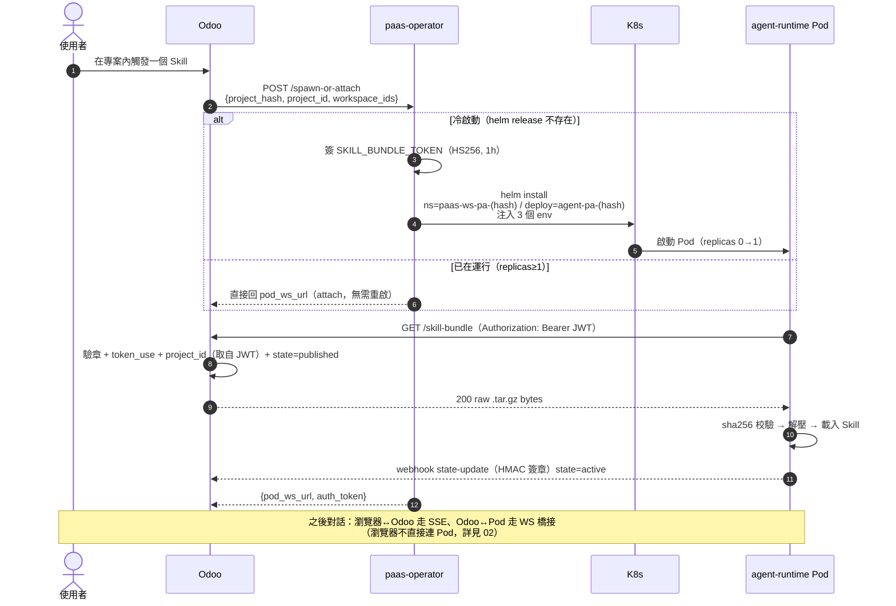
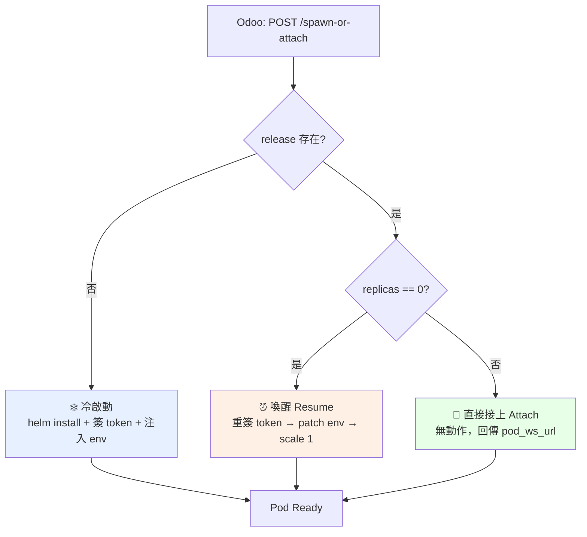
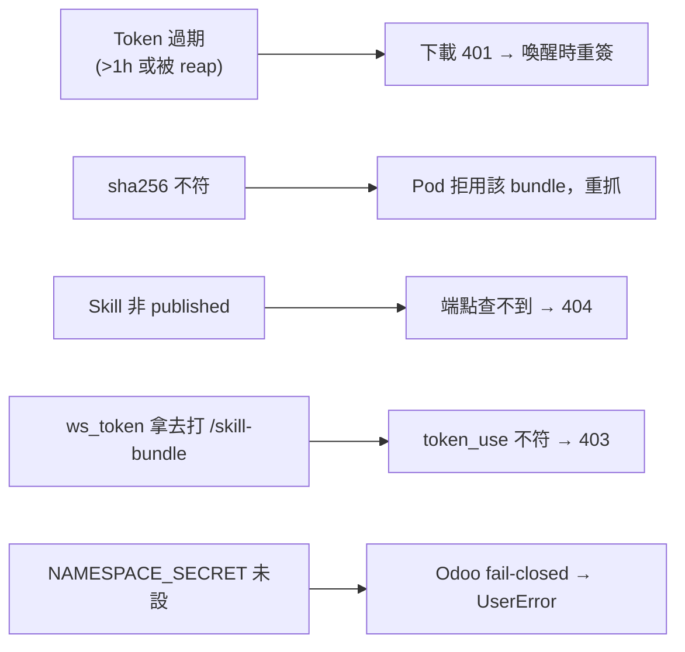

# Skill 端到端調用流程

> 把所有角色串成一個故事：使用者按下去之後，到 Skill 真的在 Pod 裡跑起來，中間發生了什麼。建議讀完 [PaaS Skill 系統總覽](README.md) 後先看這篇建立全局直覺。
>
> （本篇聚焦「Pod 怎麼被開起來」；使用者實際的對話訊息怎麼來回串流，見 [Agent 對話與串流](02-conversation-streaming.md)。）

## 🎬 全景時序圖

## 🧭 三條路徑：冷啟動 vs 喚醒 vs 直接接上

`spawn-or-attach` 是冪等的單一入口，operator 看 helm release 的狀態決定走哪條：

| 路徑 | 觸發條件 | 大致耗時 | 關鍵動作 |
|---|---|---|---|
| ❄️ 冷啟動 | release 不存在 | 數十秒 | `helm install` 全套資源 |
| ⏰ 喚醒 | release 在、replicas=0（被 reap 過） | 數秒 | **先重簽 token、patch env，再 scale 到 1**（順序很重要） |
| 🔗 接上 | release 在、replicas≥1 | 即時 | 不動 Pod，直接回 `pod_ws_url` |

> 💡 為什麼喚醒要「**先換 token 再 scale**」？因為 reap 之後原 token 早就過期了，若先 scale 起來 Pod 會拿到舊 token，下載 bundle 直接 401。順序見 [Skill 運行時生命週期](05-skill-runtime-lifecycle.md)。

## 📝 逐步拆解（冷啟動為例）

1. **使用者觸發** — 在 Odoo 專案內叫起某個 Skill。
2. **Odoo → operator** — 呼叫 `POST /spawn-or-attach`，帶 `project_hash`、`project_id`、`workspace_ids`。
3. **operator 簽 token** — `jwt_signer` 用 `AGENT_RUNTIME_AUTH_SECRET_CURRENT` 簽出 `SKILL_BUNDLE_TOKEN`（內含 `project_id`、`token_use=skill_bundle`、1h 效期）。
4. **operator 開 Pod** — `helm install` 建立 namespace、deployment、service、NetworkPolicy，並把 `ODOO_BASE_URL` / `PROJECT_HASH` / `SKILL_BUNDLE_TOKEN` 三個 env 注入 Pod。
5. **Pod 抓 bundle** — runtime 啟動，`GET /skill-bundle` 帶上 JWT。
6. **Odoo 驗證並回傳** — 驗章、確認 `token_use`、以 **JWT 內的 `project_id`** 查出 `published` 的 Skill，回傳 raw tar.gz。
7. **Pod 校驗執行** — sha256 比對 → 解壓 → 載入 → 開始執行。
8. **Pod 回報** — 透過 webhook 把 `state=active` 與 `pod_ws_url` 回報給 Odoo（HMAC 簽章）。
9. **使用者互動** — Odoo 拿到 `pod_ws_url` + `auth_token`（即 ws_token）後，**在後端**用 WebSocket 橋接到 Pod；瀏覽器端只透過 SSE 與 Odoo 來回（不直接連 Pod）。對話訊息怎麼串流見 [Agent 對話與串流](02-conversation-streaming.md)。

## 🧯 邊界與失敗情境

詳細防禦邏輯見 [Skill 系統安全模型](09-security-model.md)；下載端點細節見 [Skill Bundle 與 JWT 認證](04-skill-bundle-jwt.md)；部署/喚醒/縮容見 [Agent Runtime Pod 部署機制](07-deployment.md)；回呼通道見 [Webhook 回呼與 ws_token](08-webhook-ws-token.md)；對話串流見 [Agent 對話與串流](02-conversation-streaming.md)。
