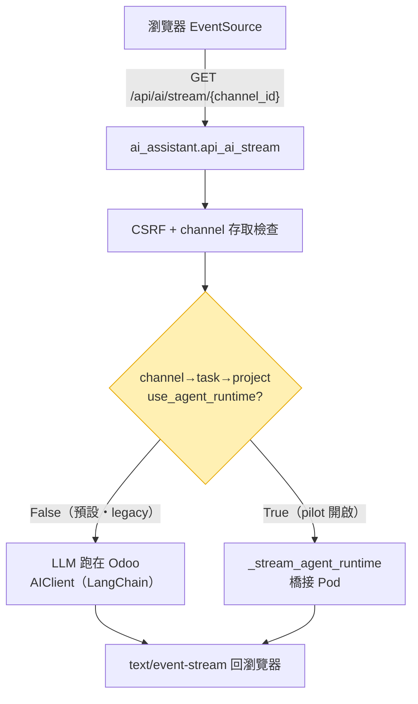
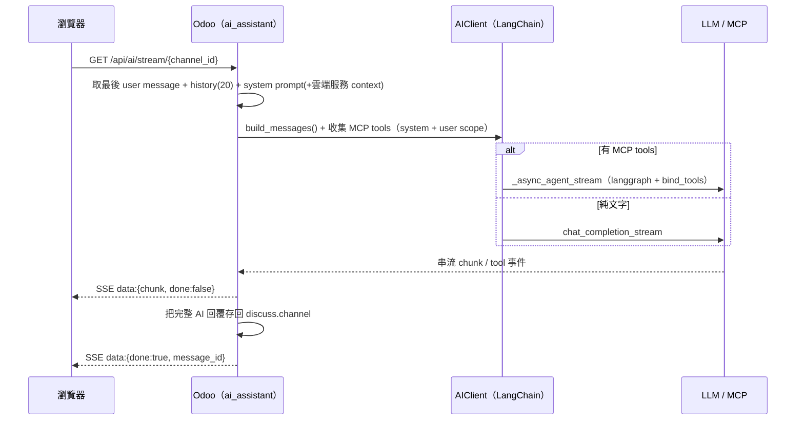
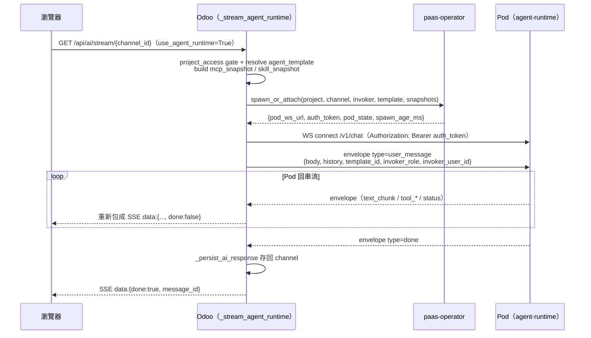

# Agent 對話與串流

> 使用者怎麼跟 LLM agent 對話、langchain 在哪被調用。關鍵洞察：**agent-runtime 不是新開一個對話入口，而是把既有 `/api/ai/stream` 這條 SSE 的「LLM 執行端」從 Odoo 內搬到 per-project 的 Pod**，前端 `EventSource` 合約完全不變。對應程式碼：`src/controllers/ai_assistant.py`、`src/models/ai_client.py`、`src/services/agent_runtime_client.py`。

## 🚪 單一前門 + 雙模式 gate

- 前門：`GET /api/ai/stream/{channel_id}`（SSE，`type=http`，`auth=user`）— `ai_assistant.py:360`
- gate：由 `channel → project.task → project.use_agent_runtime` 決定走哪邊，**預設 False**，Phase E 才對 pilot project 開 — `ai_assistant.py:384-396`

## 🅰️ Legacy 路徑：LLM 跑在 Odoo

落點：`AIClient.from_assistant()` → `build_messages()` → generator 內 `_async_agent_stream()` 或 `chat_completion_stream()`（`ai_assistant.py:403-565`）。

## 🅱️ Agent-runtime 路徑：LLM 跑在 Pod，Odoo 只橋接

落點：`_stream_agent_runtime()`（`ai_assistant.py:567`）→ `spawn_or_attach()`（`agent_runtime_client.py:60`，回 `{pod_ws_url, auth_token, pod_state, spawn_age_ms}`）→ WS 橋接（`ai_assistant.py:647-743`）。WS 的 `Bearer` 用的就是這裡的 `auth_token`（即 [Webhook 回呼與 ws_token](08-webhook-ws-token.md) 講的 ws_token）。Pod 端怎麼收這條 WS、怎麼跑，見 [agent-runtime Pod 內部](06-pod-internals.md)。

## 📨 WS Envelope 協定（Pod ↔ Odoo）

去程 Odoo 送一筆 `user_message` envelope（version 1.0，含 `request_id` / `sequence_number` / `timestamp` + payload）。回程 Pod 串流多筆 envelope，Odoo 逐筆轉成 SSE：

| Pod envelope `type` | Odoo 動作 | 送出的 SSE |
|---|---|---|
| `text_chunk` | 累加 `payload.content` | `{chunk, done:false}` |
| `tool_call` / `tool_result` / `tool_error` / `tool_unavailable` / `status` | 原樣轉發 | `{...envelope, done:false}` |
| `done` | `_persist_ai_response()` 存訊息 | `{chunk:'', done:true, full_response, message_id?}` |
| `error` | 結束（fatal 立即斷） | `{error, done:true}` |

> 🔑 前端只看得到 SSE 那一層，**兩條路徑的 SSE 事件格式一致**，所以切換 `use_agent_runtime` 對瀏覽器無感。完整 15 種 envelope type 見 [agent-runtime Pod 內部](06-pod-internals.md)。

## 📦 Odoo 傳給 Pod 的快照（snapshot）

| 傳給 Pod | 來源（`ai_assistant.py`） | 內容 |
|---|---|---|
| `agent_template` | `_resolve_agent_template`（優先 `state=published`）`:755` | 該 project 綁定的 agent 範本；無自綁時取平台預設（config_parameter `default_agent_template_id` / 內建 seed `agent_template_default`）|
| `mcp_snapshot` | `_build_mcp_snapshot` `:778` | `{servers:{name:{url, transport}}}` |
| `skill_snapshot` | `_build_skill_snapshot` `:785` | 範本已發布 skills 的 `name`/`version`/`sha` |
| `invoker_role` | `_get_project_access_role`（預設 `guest`）`:770` | 觸發者在該 project 的角色 |

> 這些快照進 Pod 的通道是 **ConfigMap mount**（`/etc/agent-runtime/*.json`）+ 熱重載，不是走 WS payload，細節見 [agent-runtime Pod 內部](06-pod-internals.md)。skill_snapshot 怎麼變成 Pod 真的下載的 bundle，見 [Skill Bundle 與 JWT 認證](04-skill-bundle-jwt.md)；skill 怎麼來，見 [Skill 設計與發布](03-skill-design.md)。

## 🧬 langchain 到底在哪被調用

| 路徑 | langchain 在哪 | 技術棧 / 狀態 |
|---|---|---|
| **Legacy**（`use_agent_runtime=False`） | **Odoo** `src/models/ai_client.py` | `langchain-openai` 的 `ChatOpenAI`（`:88`）+ `langchain-mcp-adapters` 的 `MultiServerMCPClient`（`:271`）+ `langgraph` agent graph（`bind_tools` / `StateGraph` / `ToolNode`，`:373`）— **可運作** |
| **Agent-runtime**（`True`） | **Pod** `runtime/langgraph_runtime.py`（`woow-paas-agent-runtime`） | 同樣是 langchain/langgraph stack（已是依賴）；⚠️ **agent loop 目前是 Phase B stub**（`stream()` 只回 `done`），真正 graph 待後續 phase。詳見 [agent-runtime Pod 內部](06-pod-internals.md) |

## 🧹 連線清理（F-PC-6 / P-2）

`done` / `error` 跳出 drain loop 時，relay generator 仍掛在 `async with websockets.connect()` 裡，必須 `agen.aclose()` 收掉才會觸發 WS 關閉；否則**每輪對話漏一條 pod 連線**（`ai_assistant.py:728-743`）。

## 📁 相關文件

- [Skill 端到端調用流程](01-end-to-end-flow.md) — Pod 怎麼被 spawn 起來（本篇是對話那一段的放大）
- [agent-runtime Pod 內部](06-pod-internals.md) — 這條 WS 在 Pod 端怎麼被處理
- [PaaS Skill 系統總覽](README.md)
- [Webhook 回呼與 ws_token](08-webhook-ws-token.md) — `auth_token`/ws_token 與 WebSocket 認證
- [Agent Runtime Pod 部署機制](07-deployment.md) — `spawn_or_attach` 的 operator 側
- [Skill 設計與發布](03-skill-design.md) · [Skill 系統安全模型](09-security-model.md)
