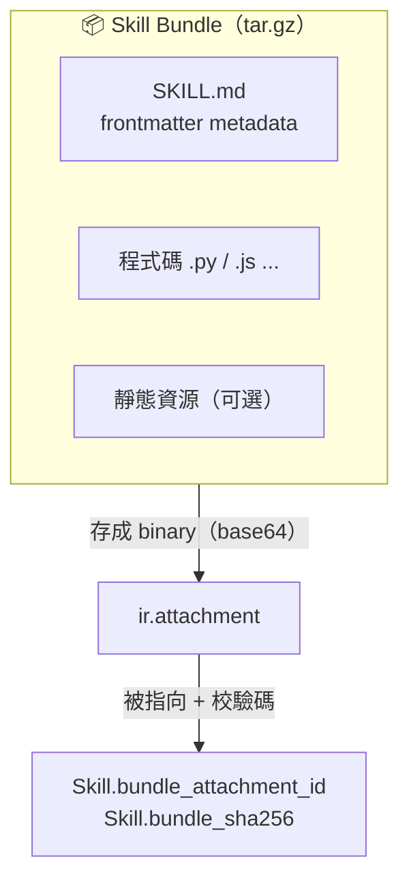
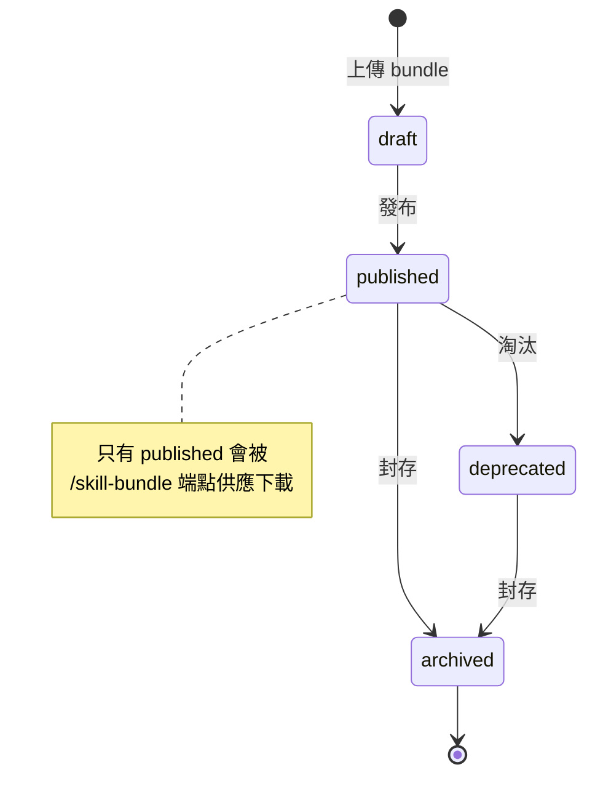
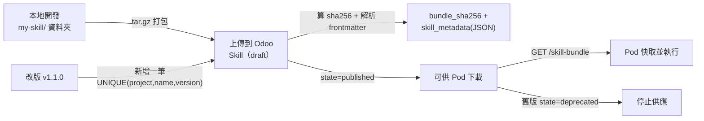

# Skill 設計與發布

> 如何建立、打包、發布一個 Skill，讓 agent-runtime Pod 能下載並執行。對應程式碼：`src/models/skill.py`。

## 🎯 什麼是 Skill？

Skill 是系統裡**最小的功能單位**，像一個可被 Pod 下載執行的外掛，由三部分組成：

- **metadata** — `SKILL.md` 的 frontmatter
- **程式碼** — Python / JavaScript 等
- **靜態資源** —（可選）

在 Odoo 端，每一個 Skill 版本是 `woow_paas_platform.skill` 的一筆記錄；實際程式被打包成 tar.gz，存進 `ir.attachment`。

## 📁 Bundle 目錄結構

```
my-skill/
├── SKILL.md          ← frontmatter metadata（至少要有 name、version）
├── src/
│   ├── __init__.py
│   ├── main.py        ← 入口程式
│   └── utils.py
└── static/            ← 靜態資源（可選）
    └── assets/
```



## 📝 SKILL.md frontmatter

> ⚠️ Odoo 端**強制的契約只有 `name` 與 `version`**（對應欄位與 UNIQUE 約束）；其餘欄位會被解析後原樣存進 `skill_metadata`（JSON），由 Pod 內的 runtime 解讀。下面是**示意**格式，實際可用欄位以 runtime 解析為準。

```yaml
---
name: my-skill            # 契約：唯一 slug
version: 1.0.0            # 契約：semver
description: 做某件事     # 以下皆 metadata（存 skill_metadata）
author: team-xxx
tags: [coding, review]
---
```

> 📌 Pod 端 `loader.py` 實際解析的 frontmatter 欄位（必填 `name`/`description`，選填 `entrypoint`/`runtime`/`timeout_seconds`/`max_output_kb`/`allowed_egress`）見 [agent-runtime Pod 內部](06-pod-internals.md)。

## 📊 Skill Model 欄位（`src/models/skill.py`）

| 欄位 | 型態 | 說明 |
|---|---|---|
| `name` | Char（required, indexed） | Skill slug |
| `title` | Char | 顯示名稱 |
| `description` | Text | 描述 |
| `version` | Char（required, 預設 `0.1.0`） | semver |
| `is_latest` | Boolean（indexed） | 是否為該 name 的最新版 |
| `project_id` | Many2one `project.project`（required, cascade delete） | 所屬專案 |
| `bundle_attachment_id` | Many2one `ir.attachment`（ondelete **restrict**） | bundle 二進位 |
| `bundle_sha256` | Char（required, readonly, indexed） | 校驗碼 |
| `bundle_size_kb` | Integer（readonly） | 大小 |
| `skill_metadata` | Text（readonly, JSON） | 解析後的 frontmatter |
| `state` | Selection | `draft` / `published` / `deprecated` / `archived` |
| `uploaded_by_uid` | Many2one `res.users`（readonly） | 上傳者 |
| `uploaded_at` | Datetime（readonly） | 上傳時間 |

**唯一約束**：`UNIQUE(project_id, name, version)`，命名 `unique_name_version_per_project`（`skill.py:83-89`）。同一專案內，一個 name 的每個 version 只能有一筆 → 改版就是「新增一筆新 version」。

## 🔄 發布生命週期





## 🔐 bundle attachment 不是普通附件

`bundle_attachment_id` 存的是可執行 payload，屬敏感資料。系統對它做了 **row-level ACL + anchor stamping** 兩層防護，避免被跨專案越權讀取。原理見 [Skill 系統安全模型](09-security-model.md)，repo 內 pattern：`docs/decisions/patterns/attachment-row-level-acl-and-anchor-stamping.md`。

## 📁 相關文件

- [PaaS Skill 系統總覽](README.md)
- [Skill Bundle 與 JWT 認證](04-skill-bundle-jwt.md) — bundle 怎麼被下載、認證
- [Skill 運行時生命週期](05-skill-runtime-lifecycle.md) — Pod 怎麼載入執行
- [Skill 系統安全模型](09-security-model.md)
