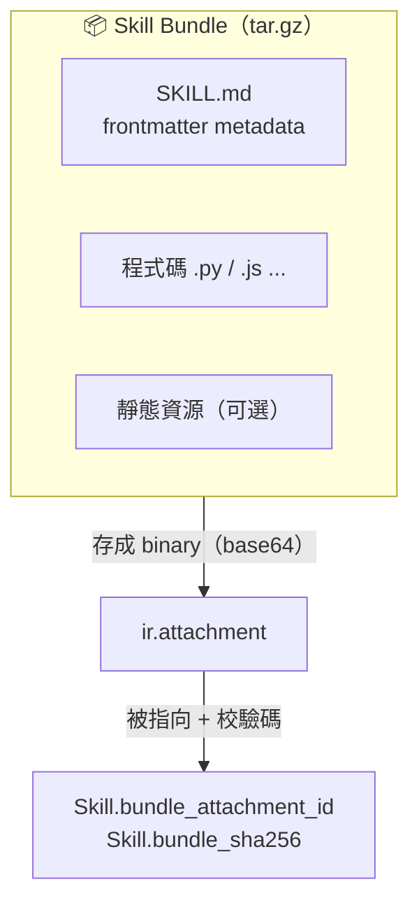
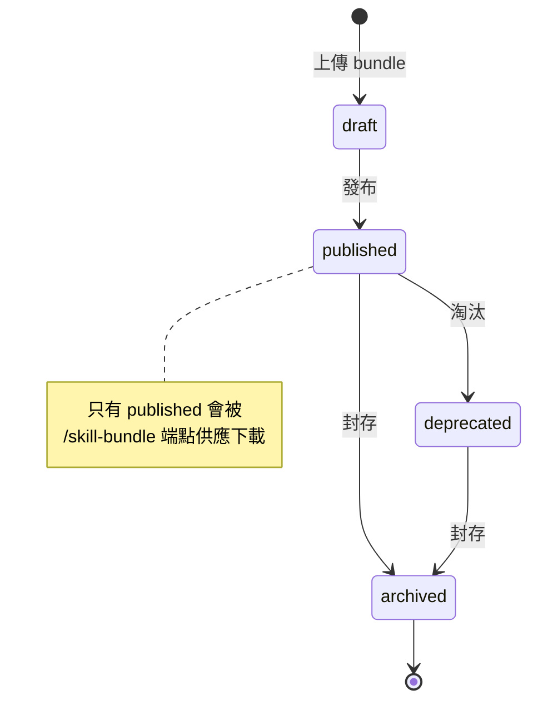
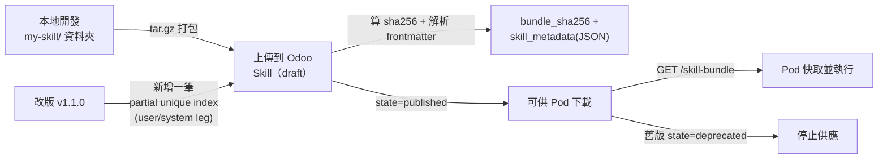

# Skill 設計與發布

> 如何建立、打包、發布一個 Skill，讓 agent-runtime Pod 能下載並執行。對應程式碼：`src/models/skill.py`。

## 🎯 什麼是 Skill？

Skill 是系統裡**最小的功能單位**，像一個可被 Pod 下載執行的外掛，由三部分組成：

- **metadata** — `SKILL.md` 的 frontmatter
- **程式碼** — Python / JavaScript 等
- **靜態資源** —（可選）

在 Odoo 端，每一個 Skill 版本是 `woow_paas_platform.skill` 的一筆記錄；實際程式被打包成 tar.gz，存進 `ir.attachment`。

## 📁 Bundle 目錄結構

```
my-skill/
├── SKILL.md          ← frontmatter metadata（至少要有 name、version）
├── src/
│   ├── __init__.py
│   ├── main.py        ← 入口程式
│   └── utils.py
└── static/            ← 靜態資源（可選）
    └── assets/
```



## 📝 SKILL.md frontmatter

> ⚠️ Odoo 端**強制的契約只有 `name` 與 `version`**（對應欄位與 UNIQUE 約束）；其餘欄位會被解析後原樣存進 `skill_metadata`（JSON），由 Pod 內的 runtime 解讀。下面是**示意**格式，實際可用欄位以 runtime 解析為準。

```yaml
---
name: my-skill            # 契約：唯一 slug
version: 1.0.0            # 契約：semver
description: 做某件事     # 以下皆 metadata（存 skill_metadata）
author: team-xxx
tags: [coding, review]
---
```

> 📌 Pod 端 `loader.py` 實際解析的 frontmatter 欄位（必填 `name`/`description`，選填 `entrypoint`/`runtime`/`timeout_seconds`/`max_output_kb`/`allowed_egress`）見 [agent-runtime Pod 內部](06-pod-internals.md)。

## 📊 Skill Model 欄位（`src/models/skill.py`）

| 欄位 | 型態 | 說明 |
|---|---|---|
| `name` | Char（required, indexed） | Skill slug |
| `title` | Char | 顯示名稱 |
| `description` | Text | 描述 |
| `version` | Char（required, 預設 `0.1.0`） | semver |
| `scope` | Selection（required, 預設 `user`, indexed） | `system` / `user`，決定 skill 層級 |
| `is_latest` | Boolean（indexed） | 是否為該 name 的最新版（**scope-aware**：system 以 `(scope, name)` 跨平台分組、user 以 `(project_id, name)` 在該 project 內分組；由 `_recompute_is_latest` 透過 `_is_latest_group_domain()` 推導分組 domain） |
| `project_id` | Many2one `project.project`（**nullable**, cascade delete） | 所屬專案。D4 由 `@api.constrains _check_scope_project_consistency` 強制：`scope=user` 必填、`scope=system` 須為 NULL（雙向） |
| `bundle_attachment_id` | Many2one `ir.attachment`（ondelete **restrict**） | bundle 二進位 |
| `bundle_sha256` | Char（required, readonly, indexed） | 校驗碼 |
| `bundle_size_kb` | Integer（readonly） | 大小 |
| `skill_metadata` | Text（readonly, JSON） | 解析後的 frontmatter |
| `state` | Selection | `draft` / `published` / `deprecated` / `archived` |
| `published_at` | Datetime（readonly） | 發布時間，`is_latest` / `_order` 排序依據 |
| `uploaded_by_uid` | Many2one `res.users`（readonly） | 上傳者 |
| `uploaded_at` | Datetime（readonly） | 上傳時間 |

**唯一約束**：由 **兩條 partial unique index** 保證，於 `skill.init()` 中建立（取代舊的單一 `UNIQUE(project_id, name, version)` / `unique_name_version_per_project`）：

| index | 範圍 | 作用 |
|---|---|---|
| `skill_uniq_user_proj_name_version` | `(project_id, name, version)` WHERE `project_id IS NOT NULL` | 同一 project 內 name+version 唯一（user-leg） |
| `skill_uniq_system_name_version` | `(name, version)` WHERE `project_id IS NULL` | 平台層 system skill name+version 全域唯一（system-leg） |

**為什麼要拆兩條**：Postgres 視 `NULL` 為彼此相異（NULL-distinct），單一 `UNIQUE(project_id, name, version)` 對 `project_id IS NULL` 的 system skill 無法去重——多筆同 name+version 的 system skill 會被當成不同列而漏掉。因此 system-leg 必須改成只索引 `(name, version)` 並以 `WHERE project_id IS NULL` 限定。同一 (project / 平台) 內一個 name 的每個 version 只能有一筆 → 改版就是「新增一筆新 version」。

## 🔄 發布生命週期





## ⬆️ 後台上傳 system skill

平台維運者（`base.group_system`）可在後台直接上傳 system skill bundle：

1. Project → Configuration → **Skills** → 右上 **⚙️ Action → 上傳 Skill**。
2. 填 **name / version**（須與 bundle 內 SKILL.md 一致）、選填 title / description，選 `.tar.gz`。
3. 送出 → 建立一筆 **draft** 的 system skill，停在其 form。
4. 檢查無誤後按 **Publish** 發布（之後所有 project 的 pod 即可載入）。

> Odoo 端**只儲存 bundle bytes 並計算 `bundle_sha256`**，不解壓、不解析 SKILL.md——
> 完整解壓與 sha256 驗證在 pod 端進行。因此 name / version 由上傳者負責填對；
> 同一 `(system, name, version)` 重複上傳會被擋下（請提升版號）。

## 🌐 Scope：system vs user

| scope | project_id | 載入範圍 | 上傳者 |
|---|---|---|---|
| `system` | NULL | **所有 project 的 pod**（platform-curated） | admin（Phase 2） |
| `user` | 必填 | 僅該 project 的 pod | project owner/admin（Phase 2） |

system skill 由 Odoo 自動 union 進每個 project 的 `_build_skill_snapshot`，並透過下載端點的
`scope='system'` fallback leg 供應（pod 端 frozen contract 不變，wire format 相同）。

> **跨 repo 註記（給 `paas-agent-runtime`）**：skills.json snapshot 現在可能含 bundle 解析為
> system-scope（`project_id` NULL）的 entry。`{name, version, sha256}` 契約與 by-name fetch
> 完全不變，pod 無需改動。

> 🔒 **scope-flip 防護是 `write()` guard，不是 ir.rule**：非 superuser 且非 `base.group_system`
> 的使用者若試圖變更 `scope` / `project_id`，由 `write()` 直接 raise `AccessError`。**ir.rule
> 無法擋這件事**，因為 record rule 評估的是**寫入前（pre-write）**的狀態，攻擊者可從合法的
> pre-write 列把 scope 翻成另一層。詳見
> [`docs/decisions/patterns/scope-flip-write-guard-not-ir-rule.md`](../../decisions/patterns/scope-flip-write-guard-not-ir-rule.md)。

## 🔐 bundle attachment 不是普通附件

`bundle_attachment_id` 存的是可執行 payload，屬敏感資料。系統對它做了 **row-level ACL + anchor stamping** 兩層防護，避免被跨專案越權讀取。原理見 [Skill 系統安全模型](09-security-model.md)，repo 內 pattern：`docs/decisions/patterns/attachment-row-level-acl-and-anchor-stamping.md`。

## 📁 相關文件

- [PaaS Skill 系統總覽](README.md)
- [Skill Bundle 與 JWT 認證](04-skill-bundle-jwt.md) — bundle 怎麼被下載、認證
- [Skill 運行時生命週期](05-skill-runtime-lifecycle.md) — Pod 怎麼載入執行
- [Skill 系統安全模型](09-security-model.md)
