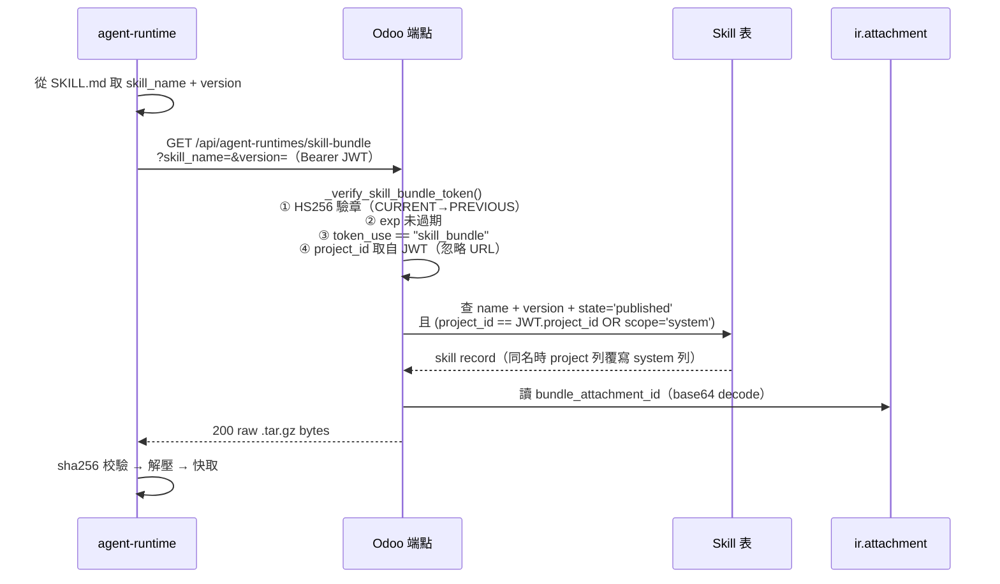
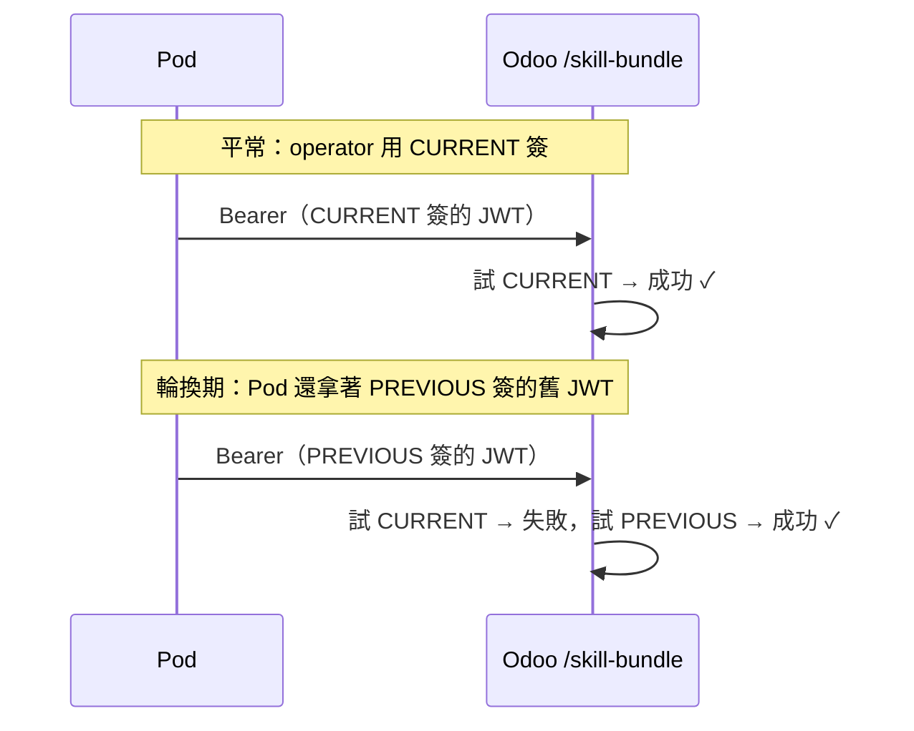

# Skill Bundle 與 JWT 認證

> Skill Bundle 是 Skill 的封包格式；Pod 透過 `SKILL_BUNDLE_TOKEN`（JWT）向 Odoo 驗證身份並下載。對應程式碼：`src/controllers/agent_runtime_skill.py`、`extra/paas-operator/src/services/jwt_signer.py`。

## 🌐 下載總流程

> route 是 `GET /api/agent-runtimes/skill-bundle`（`agent_runtime_skill.py:86-89`），回傳的是 **raw tar.gz bytes**，不是 JSON 包裝。

## 🔐 JWT 宣告（claims）

operator 的 `sign_skill_bundle_token()` 簽出（`jwt_signer.py:94-119`），演算法 **HS256（純 stdlib，無 PyJWT）**，效期 **預設 7 天（604800 秒，issue #155）**（`config.py:88-90` default=604800）。`jwt_signer.py:111` 的 `exp_seconds=3600` 僅是未顯式帶 ttl 時的 footgun fallback；兩個 production caller（cold-start install + resume re-sign）都會顯式傳 7 天的 `skill_bundle_token_ttl_seconds`：

| Claim | 值 | 用途 |
|---|---|---|
| `iss` | `"paas-operator"` | 簽發者識別 |
| `aud` | `"agent-runtime"` | 接受者驗證 |
| `token_use` | `"skill_bundle"` | **跨 scope 防禦**：ws token 不可拿來打此端點 |
| `project_id` | `int` | **權威身份**：Odoo 以此查庫，URL 參數忽略 |
| `workspace_ids` | `list[int]` | Pod 的 NetworkPolicy egress 白名單 |
| `project_hash` | `str` | namespace / release 命名 |
| `iat` / `exp` | ts | 簽發 / 到期（`exp = iat + 604800`，預設 7 天；3600 僅未帶 ttl 時的 fallback） |
| `jti` | uuid hex | 唯一識別，供 **operator 端** replay 防禦 |

## ✅ 下載端點的驗證步驟

`_verify_skill_bundle_token()`（`agent_runtime_skill.py:62-80`）+ 後續檢查：

1. **HS256 驗章** — 先試 `AGENT_RUNTIME_AUTH_SECRET_CURRENT`，失敗再試 `..._PREVIOUS`
2. **exp** — 過期即拒
3. **`token_use == "skill_bundle"`** — 否則 403（`:105`）
4. **`project_id` 取自 JWT** — 不信任 URL 的 `project_hash`（`:109`，HC-2）
5. **查庫（雙 leg）** — `name + version + state='published'` AND `('|', project_id == JWT.project_id, scope='system')`（`:113-119`）。專案綁定的 user skill 與全平台 system skill 一起被撈出；同 `(name, version)` 碰撞時 **project 列覆寫 system 列**（避免 pod `_TOOL_CACHE` 名稱衝突）。HC-2 只約束 bound leg（project_id 取自 JWT、URL 忽略）；`scope='system'` 的 skill 可被**任何有效 skill_bundle token** 撈到，是刻意設計。
6. **回傳** — 讀 `bundle_attachment_id`、base64 decode、回 raw bytes（`:125-133`）

## 🔑 雙 Secret 輪換

換 secret 時不必同時更新所有 Pod：新的用 CURRENT 簽，在途的舊 token 仍可被 PREVIOUS 驗過，達成零停機輪換。

## 🔎 jti replay 防禦在哪？（常見誤解）

> **不在這個下載端點，而在 operator。** `jwt_signer` 用一個 process 內的字典 `_JTI_SEEN` 記錄看過的 jti，TTL = **65 分**（1h token + 5 分時鐘偏移），lock 保護（`jwt_signer.py:33-35,177-179`）。Odoo 的 `/skill-bundle` 端點本身**不查 jti**，只做上面 6 步。完整安全分層見 [Skill 系統安全模型](09-security-model.md)。

## 🚫 安全檢查點小結

1. **簽章** — HS256（CURRENT→PREVIOUS）
2. **token_use** — 防 ws token 盜用 → 403
3. **project_id 權威** — bound leg 的 project_id 取自 JWT，URL 的 project_hash 完全忽略
4. **雙 leg 供應** — `state=published` 下，撈 `project_id == JWT.project_id` 或 `scope='system'`；同 `(name, version)` 時 project 列覆寫 system 列。system skill 對任何有效 token 可見
5. **jti replay** — 由 operator 端把關（非此端點）

## 📁 相關文件

- [PaaS Skill 系統總覽](README.md)
- [Skill 設計與發布](03-skill-design.md) — bundle 怎麼產生
- [Skill 運行時生命週期](05-skill-runtime-lifecycle.md) — Pod 拿到 bytes 後做什麼
- [Skill 系統安全模型](09-security-model.md) · [PaaS Skill 術語表](11-glossary.md)
