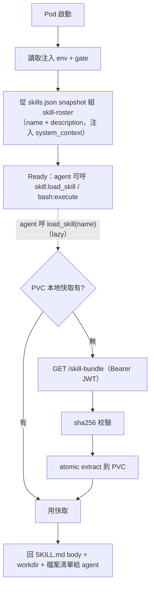
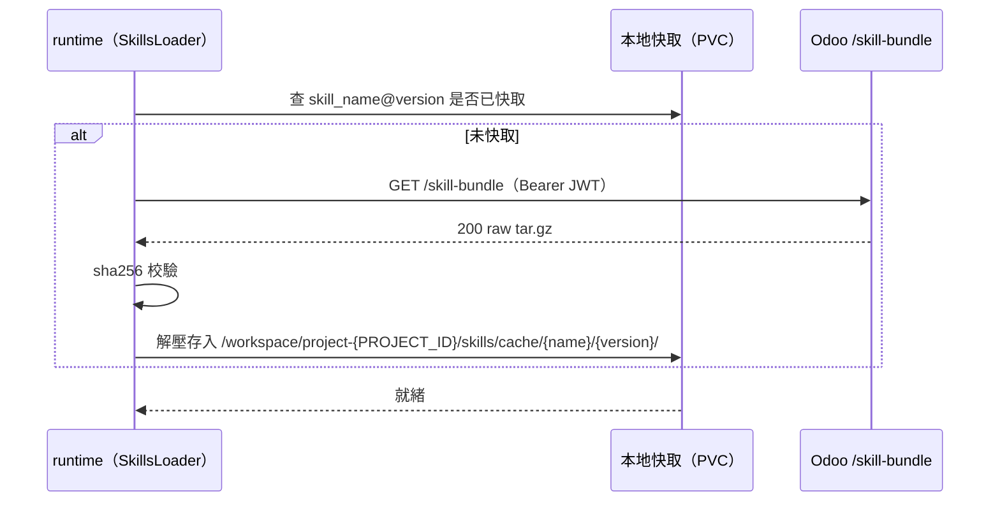
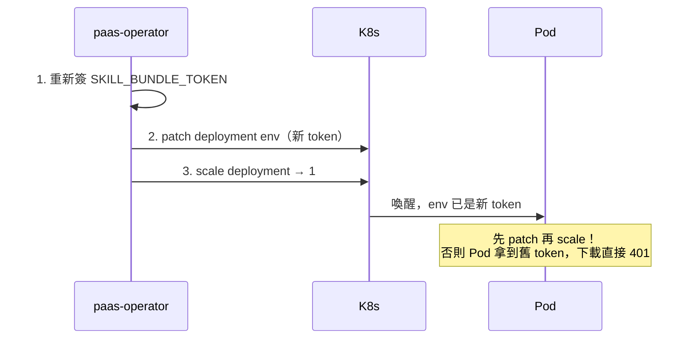
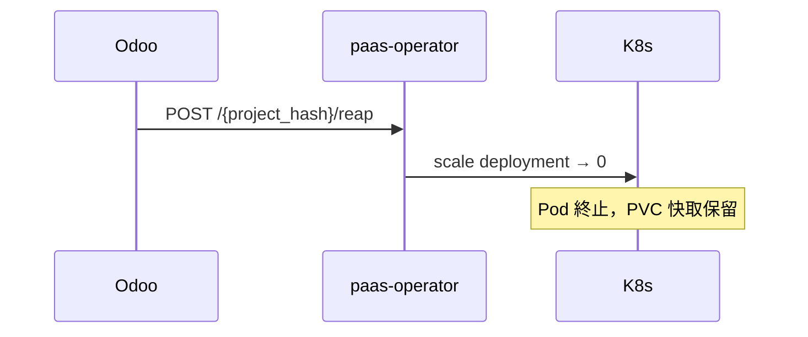

# Skill 運行時生命週期

> Pod 啟動後，runtime 如何載入、快取並執行 Skills。

> ⚠️ **執行模型更新（2026-06-09）**：Skill 執行已從「subprocess-tool（每個 skill =
> 固定 entrypoint 的 StructuredTool）」改為 **Claude Code 模型**（SKILL.md 指令注入 +
> `skill:load_skill` + 通用 `bash:execute`，bash 跑在異 UID 的 `bash_bridge` sidecar）。
> **STG 已上線並驗證（agent-runtime 1.4.0）；prod 待 Fleet flip**。設計依據見
> `docs/plans/2026-Q2/2026-06-08-skill-claude-code-model-redesign-design.md`，
> sidecar 細節見 [skill-runner（bash sidecar）](12-skill-runner-bash-sidecar.md)。

> ℹ️ **本篇是概念層**；Pod 內部的實際模組（WS 伺服器 / auth / langgraph / skill loader / 熱重載 / 安全）逐項對程式碼的細節見 [agent-runtime Pod 內部](06-pod-internals.md)。runtime 程式碼在另一個 repo `paas-agent-runtime`，本 repo（Odoo + operator）只定義 contract：下載端點、webhook、env 與 bundle 格式。

## 🔄 Pod 啟動流程

## 🌍 注入的環境變數

operator 在 `spawn-or-attach` 時注入下載 bundle 用的 3 個 env：

| env | 說明 |
|---|---|
| `ODOO_BASE_URL` | Odoo 實例 URL（下載 bundle、回呼 webhook 用） |
| `PROJECT_HASH` | 專案 namespace hash（16 字元 base32） |
| `SKILL_BUNDLE_TOKEN` | JWT，下載 bundle 用（baked-in，預設 7 天 TTL） |

外加一個 **gate env**（Drop B / Claude Code 模型）：

| env | 說明 |
|---|---|
| `AGENT_RUNTIME_SKILL_RUNNER_ENABLED` | agent container 上的開關；`true` 才暴露 `bash:execute`，且 pod 多掛一個 `bash_bridge` sidecar container。由 operator 依 `skillRunner.enabled` 顯式設定，**預設 false（fail-closed）**。細節見 [skill-runner（bash sidecar）](12-skill-runner-bash-sidecar.md) |

> ⚠️ 簽章用的 `AGENT_RUNTIME_AUTH_SECRET_*`、webhook secret、namespace secret **都不在 Pod**，那是 Odoo 端用來簽/驗的（由 charts mount）。見 [Skill 系統安全模型](09-security-model.md)。

## 📥 Bundle 下載與快取

快取放在 **PVC**，所以 reap（縮容到 0）不會清掉，下次喚醒可直接命中。

## 🛠️ Skill 怎麼被執行（Claude Code 模型）

runtime **不再**把每個 skill 包成固定 entrypoint 的 tool。改為兩個通用 tool + roster 注入：

| tool | 行為 | 回傳 |
|---|---|---|
| `skill:load_skill(name)` | agent 判斷要用某 skill 時呼叫；走 `ensure_skill_cached` lazy fetch+extract，讀回 SKILL.md | `{name, description, body, workdir, files[]}` |
| `bash:execute(cmd, timeout_seconds?)` | 通用 shell（可 `pip install`）；cwd 預設 `/workspace`，agent 通常先 `cd` 進 `load_skill` 回的 `workdir` | `{stdout, stderr, exit_code, truncated}` |

- **progressive disclosure**：啟動時把 effective skills 的 `name + description` 組成 roster 注入 system_context；skill 全文（body）等 agent 呼 `load_skill` 才載入。
- `bash:execute` 的 bash 子行程跑在**同 pod 的 `bash_bridge` sidecar container**，用異於 agent 的 UID（`runAsUser=10002`）+ PID namespace 隔離執行——隔離原理見 [Skill 系統安全模型](09-security-model.md) 與 [skill-runner（bash sidecar）](12-skill-runner-bash-sidecar.md)。
- tool 命名前綴 `skill:` / `bash:` / `mcp:<orig>`，pod 啟動偵測同名即 fail-loud。

## ⚡ 喚醒時的 Token 刷新（順序很關鍵）

## 🛑 縮容（Reap）

## 📁 相關文件

- [PaaS Skill 系統總覽](README.md) · [Skill 端到端調用流程](01-end-to-end-flow.md)
- [agent-runtime Pod 內部](06-pod-internals.md) — Pod 內部模組對程式碼的細節
- [Skill Bundle 與 JWT 認證](04-skill-bundle-jwt.md) — 下載端點細節
- [Agent Runtime Pod 部署機制](07-deployment.md) — operator 怎麼 scale/patch
- [Webhook 回呼與 ws_token](08-webhook-ws-token.md) — Pod 啟動後怎麼回報
