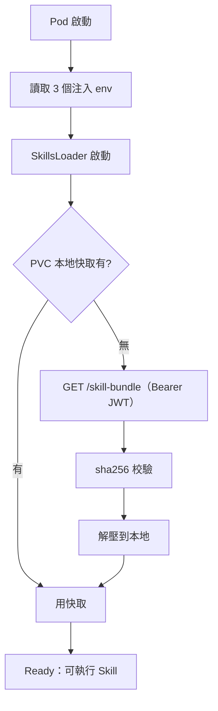
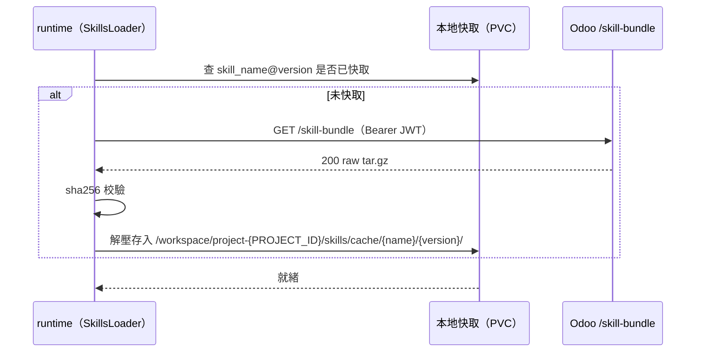
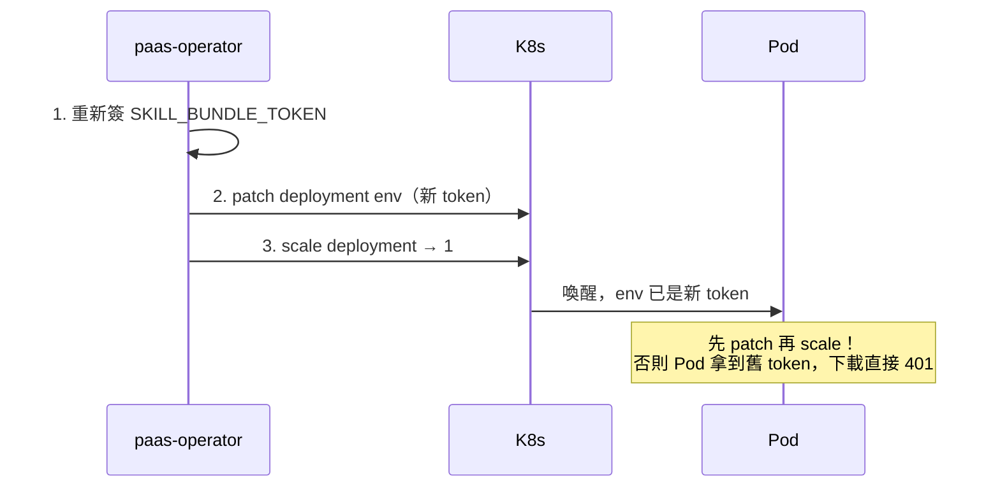
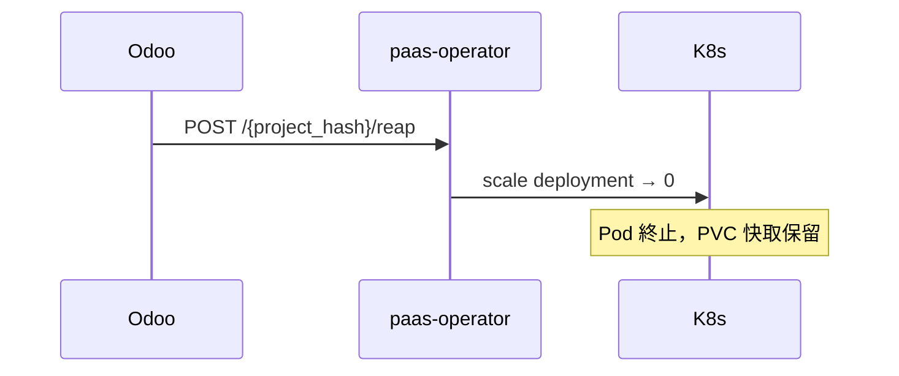

# Skill 運行時生命週期

> Pod 啟動後，runtime 如何載入、快取並執行 Skills。

> ℹ️ **本篇是概念層**；Pod 內部的實際模組（WS 伺服器 / auth / langgraph / skill loader / 熱重載 / 安全）逐項對程式碼的細節見 [agent-runtime Pod 內部](06-pod-internals.md)。runtime 程式碼在另一個 repo `woow-paas-agent-runtime`，本 repo（Odoo + operator）只定義 contract：下載端點、webhook、env 與 bundle 格式。

## 🔄 Pod 啟動流程

## 🌍 注入的環境變數（只有 3 個）

operator 在 `spawn-or-attach` 時注入：

| env | 說明 |
|---|---|
| `ODOO_BASE_URL` | Odoo 實例 URL（下載 bundle、回呼 webhook 用） |
| `PROJECT_HASH` | 專案 namespace hash（16 字元 base32） |
| `SKILL_BUNDLE_TOKEN` | JWT，1h 效期，下載 bundle 用 |

> ⚠️ 簽章用的 `AGENT_RUNTIME_AUTH_SECRET_*`、webhook secret、namespace secret **都不在 Pod**，那是 Odoo 端用來簽/驗的（由 charts mount）。見 [Skill 系統安全模型](09-security-model.md)。

## 📥 Bundle 下載與快取

快取放在 **PVC**，所以 reap（縮容到 0）不會清掉，下次喚醒可直接命中。

## ⚡ 喚醒時的 Token 刷新（順序很關鍵）

## 🛑 縮容（Reap）

## 📁 相關文件

- [PaaS Skill 系統總覽](README.md) · [Skill 端到端調用流程](01-end-to-end-flow.md)
- [agent-runtime Pod 內部](06-pod-internals.md) — Pod 內部模組對程式碼的細節
- [Skill Bundle 與 JWT 認證](04-skill-bundle-jwt.md) — 下載端點細節
- [Agent Runtime Pod 部署機制](07-deployment.md) — operator 怎麼 scale/patch
- [Webhook 回呼與 ws_token](08-webhook-ws-token.md) — Pod 啟動後怎麼回報
