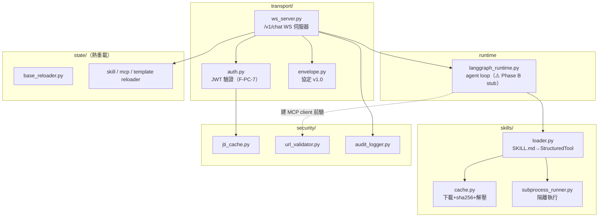
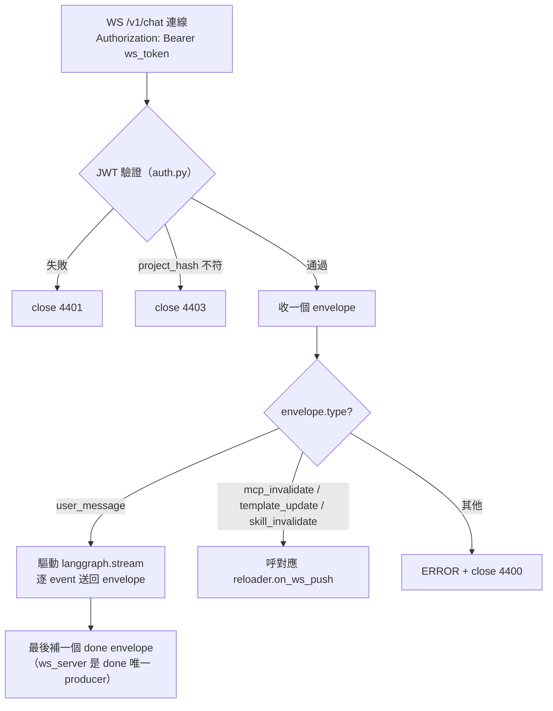
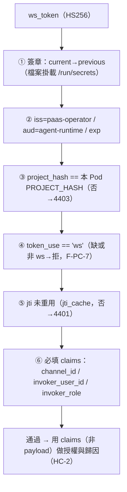
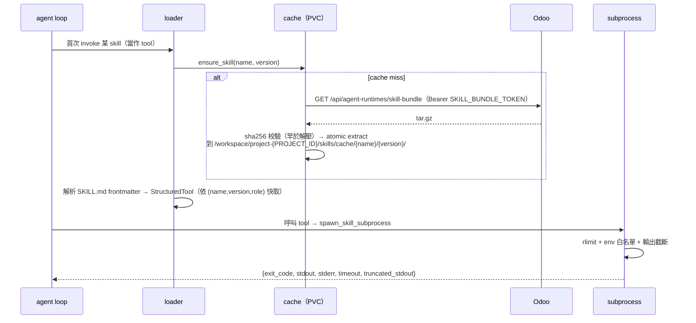
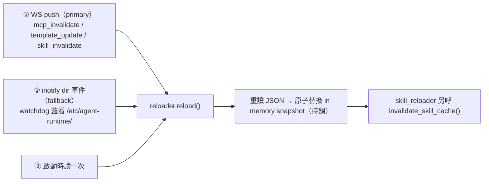

# agent-runtime Pod 內部

> contract 的 Pod 那一端。程式碼在 `woow-paas-agent-runtime` repo（`runtime/`）。這篇補齊 [Agent 對話與串流](02-conversation-streaming.md) 裡「Pod 內怎麼跑」的細節。

> 🚧 **重要狀態（誠實標註）**：transport（WS / 認證 / envelope）、skill 載入與執行、熱重載、安全機制**都已實作**；但**真正的 agent loop `runtime/langgraph_runtime.py` 目前是 Phase B stub**：`initialize()` 是 no-op、`stream()` 只 yield 一個 `done`。langchain / langgraph 已是依賴、`stream()` 的契約簽名已定，但**實際的 LLM graph 調用待後續 phase**。換言之，今天若 `use_agent_runtime=True` 接上，Pod 會完成認證、收訊息，但 agent 還不會真的回話。

## 🗂️ 模組地圖

## 🚀 開機與入口

- FastAPI app：`runtime.transport.ws_server:app`，uvicorn `--host 0.0.0.0 --port 8000`（`Dockerfile:55`）
- WS 路徑：**`/v1/chat`**（凍結，`ws_server.py:73`）
- `lifespan`：`runtime.initialize()` + 啟動 3 個 reloader 的 watchdog observer（`ws_server.py:57-67`）
- 讀的環境變數：

| env | 必填 | 用途 |
|---|---|---|
| `PROJECT_HASH` | ✅ | Pod 身份、token `project_hash` 比對、audit |
| `PROJECT_ID` | ✅ | skill 快取目錄路徑成分 |
| `ODOO_BASE_URL` | 選 | skill-bundle 下載 base |
| `SKILL_BUNDLE_TOKEN` | 選 | 下載 bundle 的 Bearer（fallback `SHARED_SECRET`） |
| `WORKSPACE_ROOT` | 選（預設 `/workspace`） | PVC 快取掛載點 |
| `AUTH_SECRET_DIR` | 選（預設 `/run/secrets/...`） | JWT secret 檔案掛載目錄 |

## 🔌 WS 伺服器（`/v1/chat`）

每條連線處理「一個」Odoo→Pod envelope（short-lived per-envelope）。

- 同 `channel_id` 的請求以 per-thread `asyncio.Lock` 序列化，跨 channel 並行（`ws_server.py:37-46,157-160`）
- 關閉碼：`4401` auth 失敗 / `4403` project_hash 不符 / `4400` protocol violation（`ws_server.py:16`）

## 🔐 JWT 驗證（auth.py，F-PC-7 嚴格）

- 演算法 HS256；secret 由 **K8s Secret 檔案掛載**讀（`auth.py:52,55-74`），雙 secret 輪換（簽章錯才 fallback previous，exp/aud/iss 錯不 fallback）
- **HC-2**：`channel_id` / `invoker_user_id` / `invoker_role` 取自**已驗證的 token claims**，Odoo envelope payload 同名欄位只當 LangGraph input，不做安全決策（`ws_server.py:142-148`）

## 📨 Envelope 協定 v1.0（`envelope.py`）

- 7 欄位：`version`(="1.0") / `type` / `request_id` / `correlation_id?` / `sequence_number` / `timestamp` / `payload`
- Pydantic `frozen=True` + `extra="forbid"`（不允許多餘欄位）（`envelope.py:58-74`）
- 15 種 type（凍結）：
  - **Odoo→Pod（6）**：`user_message` / `cancel` / `template_update` / `mcp_invalidate` / `skill_invalidate` / `ping`
  - **Pod→Odoo（9）**：`text_chunk` / `tool_call` / `tool_result` / `tool_error` / `tool_unavailable` / `status` / `error` / `done` / `pong`
- Pod→Odoo 回程 `sequence_number` 從 1 起遞增，`done` 帶 `full_response` + `usage`（`ws_server.py:162-196`）

> 這 9 種回程 type 對應 [Agent 對話與串流](02-conversation-streaming.md) 裡 Odoo 把 envelope 轉成 SSE 的那張表。

## 🧠 Agent loop（`langgraph_runtime.py`）— ⚠️ Phase B stub

- module singleton `runtime = LangGraphRuntime()`
- `stream(thread_id, user_message, history, template_id, invoker_role) → AsyncIterator[Event]`（契約已定）
- `Event` dataclass：`type` / `payload` / `full_response` / `usage`
- **現況**：`initialize()` no-op；`stream()` 只 `yield Event(type="done")`。真正的「resolve tools → LangGraph `astream` → 逐 event yield」待後續 phase（`langgraph_runtime.py:37-54`）
- 已知缺陷 **SC-5**：stub 自己 yield done、ws_server 又補一個 done → 雙 done；契約上 ws_server 才是 done 唯一 producer，後續要移除 stub 的 yield（`docs/PHASE_B_HANDOFF.md:19-27`）

## 🧩 Skill 載入與執行

- **loader**：SKILL.md frontmatter 必填 `name`/`description`，選 `entrypoint`(預設 `scripts/main.py`)/`runtime`/`timeout_seconds`(30)/`max_output_kb`(64)/`allowed_egress`；包成 `StructuredTool` 給 LLM（`loader.py:33-90`）。tool 依 `(name, version, invoker_role)` 快取（role 隔離，SC-7）
- **cache**：lazy fetch，sha256 **早於**解壓，`tarfile filter="data"` 擋 path traversal，atomic extract（`cache.py:47-107`）
- **subprocess_runner**：硬 rlimit（CPU 30s / AS 512MB / NOFILE 64 / NPROC 16 / FSIZE 100MB）、wall timeout `min(宣告, 60s)`、**env 白名單**（只放 PATH/HOME/LANG/PROJECT_HASH，**絕不**漏 OPENAI_API_KEY / MCP key / SHARED_SECRET）、stdout 截斷（`subprocess_runner.py:25-110`）

## ♻️ 熱重載（ConfigMap）

- 監看**目錄**而非檔案（K8s 用 atomic symlink swap）；缺檔瞬間保留舊 snapshot（`base_reloader.py:50-105`）
- 三份快照（Odoo 傳來的）：`/etc/agent-runtime/skills.json` · `mcp.json` · `template.json`
- 已知缺陷 **SC-4**：mcp / template reloader 還缺「tool_set 失效 hook」，真正的 LangGraph 接上後改 snapshot 可能 silently 不生效（`mcp_reloader.py` / `template_reloader.py`）

## 🛡️ 安全

| 機制 | 細節 | 出處 |
|---|---|---|
| `jti_cache` | `TTLCache(maxsize=10000, ttl=65min)`，per-pod in-memory，pod restart 重置 | `security/jti_cache.py:1-27` |
| `url_validator` | 建 MCP client 前再驗 URL（defense in depth）：拒 non-http(s)、link-local 169.254/fe80、IMDS、decimal/hex/octal 繞過；放行 `*.svc.cluster.local` | `security/url_validator.py:1-69` |
| `audit_logger` | 一行 JSON 到 **stdout**；必填 `ts/level/event/project_hash`；15 種 event（凍結）；**PII redaction**（mail body 不寫 log） | `security/audit_logger.py:18-94` |

## 🔗 Odoo ↔ Pod contract 對照

| 東西 | 通道 | 備註 |
|---|---|---|
| `user_message` payload（body / history / template_id …） | WS envelope | security 欄位取 claims 非 payload（HC-2） |
| `skill_snapshot` / `mcp_snapshot` / `agent_template` | **ConfigMap mount** `/etc/agent-runtime/*.json`（非 WS payload） | 由 reloader 套用，免重啟 |
| `PROJECT_HASH` / `PROJECT_ID` / `ODOO_BASE_URL` / `SKILL_BUNDLE_TOKEN` | **spawn 時的 Pod env** | 見 [Agent Runtime Pod 部署機制](07-deployment.md) |

## 📁 相關文件

- [Agent 對話與串流](02-conversation-streaming.md) — Odoo 側怎麼接上這個 WS（本篇的另一端）
- [Skill 運行時生命週期](05-skill-runtime-lifecycle.md) — Pod 生命週期（概念層）
- [Skill Bundle 與 JWT 認證](04-skill-bundle-jwt.md) — `/skill-bundle` 下載端點（Odoo 側）
- [Skill 系統安全模型](09-security-model.md) · [PaaS Skill 系統總覽](README.md)
