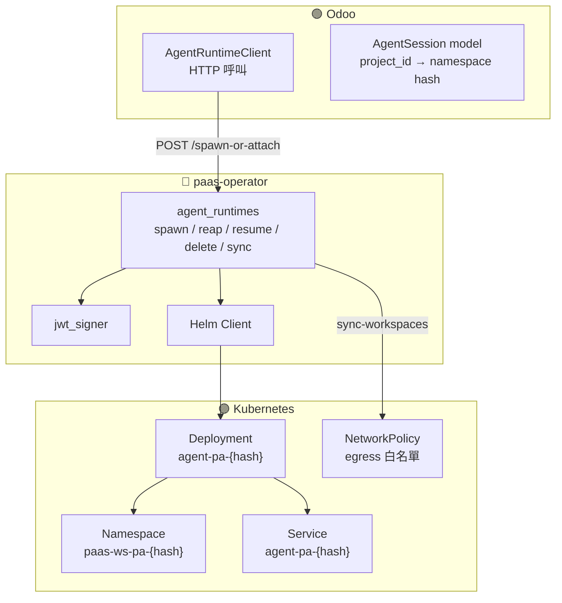
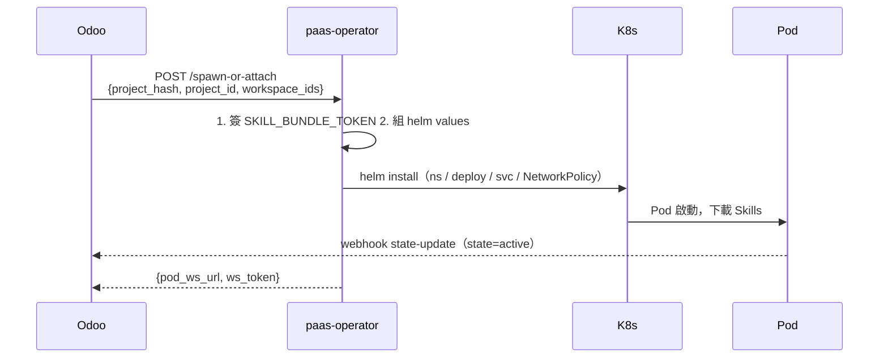
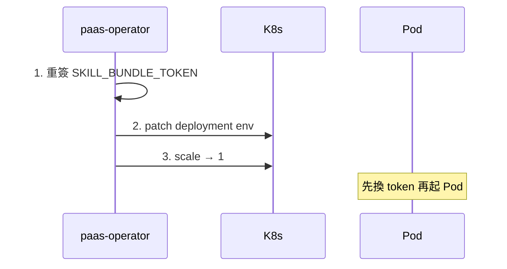
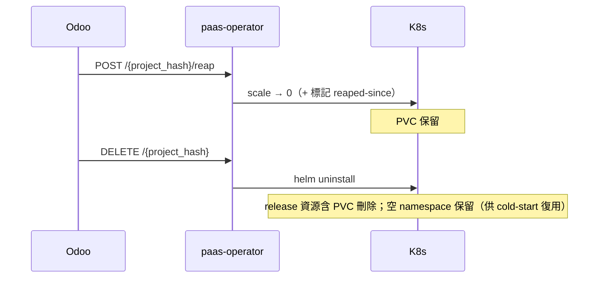
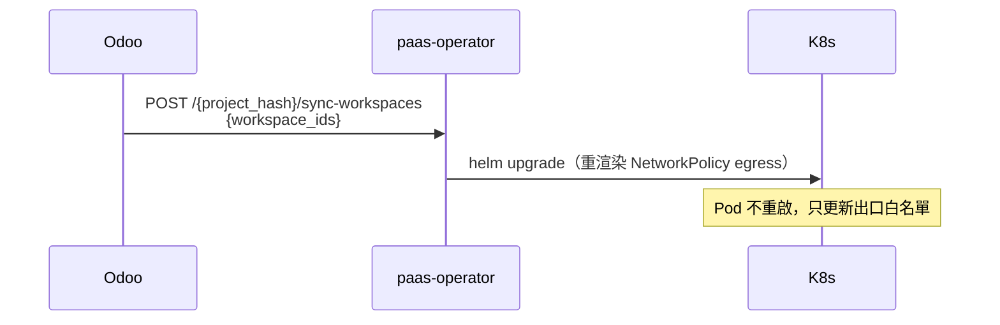

# Agent Runtime Pod 部署機制

> Odoo 如何透過 paas-operator 在 K8s 上啟動、喚醒、縮容、刪除 Pod。對應程式碼：`extra/paas-operator/src/api/agent_runtimes.py`、`src/models/agent_session.py`。

## 🏗️ 核心架構

## 🎛️ Operator 端點一覽

| 端點 | 動作 |
|---|---|
| `POST /spawn-or-attach` | 冷啟動 / 喚醒 / 接上（三合一冪等入口） |
| `POST /{project_hash}/reap` | scale → 0（保留 PVC 快取） |
| `POST /{project_hash}/resume` | 重簽 token → patch env → scale → 1 |
| `POST /{project_hash}/sync-workspaces` | helm upgrade 重渲染 NetworkPolicy egress |
| `DELETE /{project_hash}` | helm uninstall（連 namespace 一起刪） |

## ❄️ 冷啟動（首次）

## ⏰ 喚醒（Resume）

## ⏸️ 縮容（Reap）／🔴 刪除（Delete）

> 🔴 DELETE = helm uninstall，**PVC 連帶刪除**（chart 無 keep policy；只含可重抓的 skill cache）、
> **空 namespace 保留**（operator 預建 ns、install 帶 `create_namespace=False`，uninstall 不碰 ns）。
> 這也是 **image 升版唯一路徑**（reap/resume 不重 render image），完整程序見
> [agent-runtime image 升版 SOP](../deployment/agent-runtime-image-upgrade-sop.md)。

## 🔄 同步 workspace egress（Sync-workspaces）

## 🧩 skill-runner sidecar 開關（Drop B）

operator `_build_install_values` 會把 `skillRunner.enabled` **顯式**（true/false 都設）forward 給 agent-runtime chart，由 env `AGENT_RUNTIME_SKILL_RUNNER_ENABLED` 驅動（`extra/paas-operator/src/config.py` 的 `agent_runtime_skill_runner_enabled`，**預設 false**）。同一個 chart 值同時決定：① 是否起 `bash_bridge` sidecar container；② agent container gate env → runtime 是否暴露 `bash:execute`。

- **為何顯式雙向**：sidecar-aware chart 預設 `skillRunner.enabled=true`，若「關閉就省略」會讓 chart 預設值贏 → operator env 關不掉。顯式設才是真正的 kill-switch。
- **硬約束**：flip 時 agent-runtime image 必須 `≥1.4.0`（含 `bash_bridge`）+ chart `0.4.0`，否則 crashloop。
- **既有 pod 不會自動套用**：改 `AGENT_RUNTIME_SKILL_RUNNER_ENABLED` 走 cold-start path，既有 pod 需 respawn（同 image 升版的 reap 邏輯）才生效。

完整 kill-switch 鏈、4 個跨組件 gap、異 UID 安全模型見 [skill-runner（bash sidecar）](12-skill-runner-bash-sidecar.md)。

## 🆔 命名規則與 hash（重要）

| 資源 | 命名 |
|---|---|
| Namespace | `paas-ws-pa-{hash}` |
| Deployment | `agent-pa-{hash}` |
| Service | `agent-pa-{hash}` |
| NetworkPolicy | `agent-pa-{hash}` |

> 🔧 **hash 是 16 字元小寫 base32，不是 8 字元 hex**（這是最常見的誤讀）。
> 算法：`base32( HMAC-SHA256(project_id, secret).digest()[:10] ).lower()`（`src/models/agent_session.py:22-31`）。前 10 bytes = 80 bits → 16 個 base32 字元（字元集 `a-z2-7`）。

## 📁 相關文件

- [PaaS Skill 系統總覽](README.md) · [Skill 端到端調用流程](01-end-to-end-flow.md)
- [Skill 運行時生命週期](05-skill-runtime-lifecycle.md) — Pod 內部視角
- [Webhook 回呼與 ws_token](08-webhook-ws-token.md) — Pod 怎麼回報
- [Skill 系統安全模型](09-security-model.md) · [PaaS Skill 術語表](11-glossary.md)
- [skill-runner（bash sidecar）](12-skill-runner-bash-sidecar.md) — `skillRunner.enabled` kill-switch 全貌
- [agent-runtime image 升版 SOP](../deployment/agent-runtime-image-upgrade-sop.md) — operator/platform 視角升版 runbook（tag 注入鏈、DELETE reap 程序）
