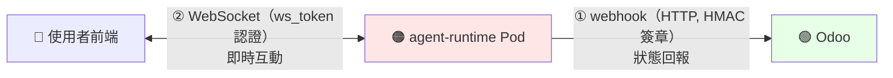
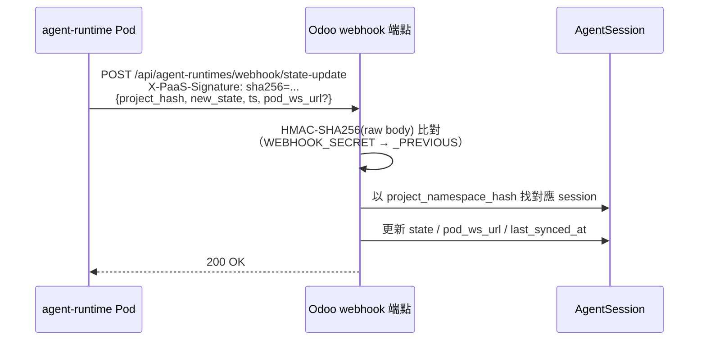

# Webhook 回呼與 ws_token

> 前面幾篇講的是 Odoo→operator→Pod 的「去程」。這篇講**回程與即時通道**：Pod 怎麼回報狀態（webhook），以及使用者怎麼即時和 Pod 互動（ws_token）。對應程式碼：`src/controllers/agent_runtime_webhook.py`、`extra/paas-operator/src/services/jwt_signer.py`。

## 🔁 兩條反向／即時通道

## ① Webhook：Pod → Odoo 狀態回報

- **route**：`POST /api/agent-runtimes/webhook/state-update`
- **簽章**：HMAC-SHA256 對 **raw body bytes**，放在 header `X-PaaS-Signature: sha256=<hex>`
- **雙 secret**：先 `AGENT_RUNTIME_WEBHOOK_SECRET`（current 裸名），失敗再試 `..._PREVIOUS`
- **payload**：`{project_hash, new_state, ts, pod_ws_url?, spawn_age_ms?, reason?}`
- **效果**：用 `project_namespace_hash` 找 `AgentSession`，同步 `state` / `pod_ws_url` / `last_synced_at`

## ② ws_token：WebSocket 互動認證

operator 的 `sign_ws_token()`（`jwt_signer.py:68-91`）簽出，**per-invocation**（每次調用一張）：

| Claim | 值／說明 |
|---|---|
| `iss` / `aud` | `paas-operator` / `agent-runtime` |
| `token_use` | `"ws"` |
| `project_hash` | 專案 hash |
| `channel_id` | 該次 WebSocket 通道 |
| `invoker_user_id` | 觸發者 user id |
| `invoker_role` | 觸發者角色 |
| `iat` / `exp` | 簽發 / 到期（1h） |
| `jti` | 唯一識別 |

> 💬 這張 ws_token 怎麼被拿去開 WebSocket、Odoo 怎麼把 Pod 的串流橋接回瀏覽器，見 [Agent 對話與串流](02-conversation-streaming.md)（`spawn_or_attach` 回傳的 `auth_token` 就是它）。

## 🔍 ws_token vs SKILL_BUNDLE_TOKEN

| | SKILL_BUNDLE_TOKEN | ws_token |
|---|---|---|
| 用途 | 下載 Skill bundle | WebSocket 互動認證 |
| `token_use` | `skill_bundle` | `ws` |
| 簽發時機 | spawn / resume | 每次調用 |
| 專屬 claim | `project_id`, `workspace_ids` | `channel_id`, `invoker_user_id`, `invoker_role` |
| jti replay 防禦 | ✅ 有（operator 端） | ❌ 無（per-invocation，重用無意義） |
| 效期 | 1h | 1h |

> 兩種 token 用 `token_use` 嚴格分流：ws_token 拿去打 `/skill-bundle` 會因 `token_use != "skill_bundle"` 被擋（403）。這是 C-1 防禦，詳見 [Skill 系統安全模型](09-security-model.md)。

## 📁 相關文件

- [PaaS Skill 系統總覽](README.md) · [Skill 端到端調用流程](01-end-to-end-flow.md)
- [Agent 對話與串流](02-conversation-streaming.md) — ws_token 實際怎麼被用在對話串流
- [Agent Runtime Pod 部署機制](07-deployment.md) · [Skill 運行時生命週期](05-skill-runtime-lifecycle.md)
- [Skill 系統安全模型](09-security-model.md) · [PaaS Skill 術語表](11-glossary.md)
