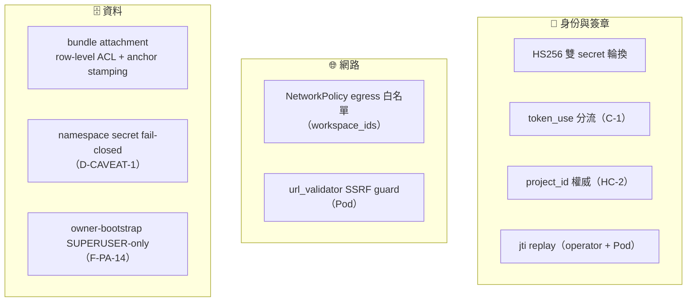
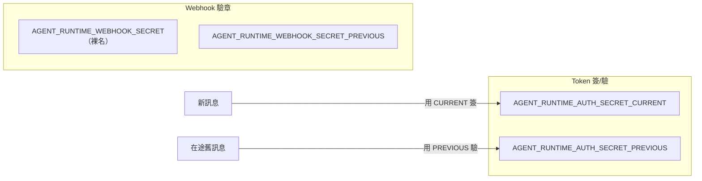
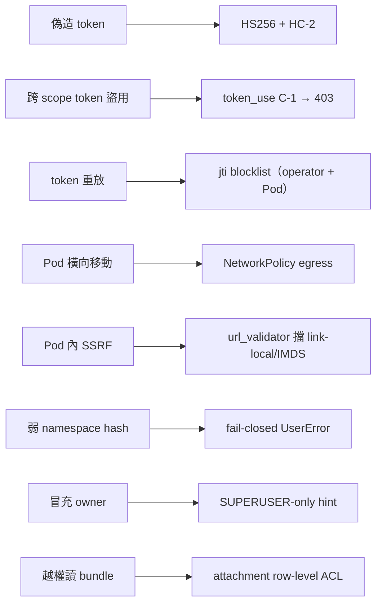

# Skill 系統安全模型

> 把散落各篇的安全機制整合成一張威脅地圖。核心假設：**Pod 是半信任的**——它可能被攻擊者影響，所以每道介面都要能獨立把關。

## 🛡️ 防禦分層

## 🔑 雙 Secret 輪換（簽章與 webhook 各一組）

驗證一律「先 CURRENT、失敗再 PREVIOUS」，所以換 secret 不必同時更新所有 Pod，零停機。

## 🎯 核心防禦原語

| 代號 | 機制 | 防什麼 |
|---|---|---|
| **C-1** | `token_use` 斷言（`ws` ≠ `skill_bundle`） | 拿 ws_token 盜打 `/skill-bundle` → 403 |
| **HC-2** | `project_id` 以 **JWT 為準**，忽略 URL | 改 URL 參數越權讀他人 bundle |
| **jti replay** | operator（`_JTI_SEEN`）+ Pod（`jti_cache`）各一個，TTL 65 分 | 重放擷取到的 token |
| **NetworkPolicy** | egress 白名單 = `workspace_ids` | Pod 橫向打其他 workspace |
| **url_validator** | Pod 建 MCP client 前驗 URL，拒 link-local / IMDS | Pod 內 SSRF |
| **D-CAVEAT-1** | namespace secret **fail-closed** | secret 未設時退化成弱 hash（改為直接 `UserError`） |
| **F-PA-14** | owner-bootstrap hint 僅 SUPERUSER 讀 | 透過 HTTP 注入 context 冒充 owner |
| **attachment ACL** | row-level ACL + anchor stamping | 跨專案讀取 bundle 二進位 payload |

## 🧨 威脅 → 對策

## ⚠️ 跨 repo 部署順序風險（D-CAVEAT-2 / F-PC-7）

`token_use` 的嚴格驗證在 Pod 端（`paas-agent-runtime` 的 F-PC-7，已實作於 `runtime/transport/auth.py`）。**翻開 enable-gate 前，必須先把 F-PC-7 merge 到 main 並部署**，否則存在 1 小時在途 token 的空窗。狀態追蹤見 [Agent Runtime 演進史 (Phase A~G)](10-roadmap-phases.md)；實際翻 gate 步驟見 repo 的 `docs/guides/deployment/agent-runtime-pilot-flip-gate-runbook.md`。

## 📚 本 repo 對應 pattern（`docs/decisions/patterns/`）

- `constraint-input-trust-expansion.md` — 對應 HC-2（輸入信任邊界）
- `attachment-row-level-acl-and-anchor-stamping.md` — bundle 附件兩層防護
- `credential-claim-test-fixture-coupling.md` — credential 硬化後 test fixture 的連動紀律

## 📁 相關文件

- [PaaS Skill 系統總覽](README.md)
- [Skill Bundle 與 JWT 認證](04-skill-bundle-jwt.md) — 下載端點驗證
- [Webhook 回呼與 ws_token](08-webhook-ws-token.md) — 回呼簽章
- [agent-runtime Pod 內部](06-pod-internals.md) — Pod 端 auth / jti / url_validator
- [Agent Runtime Pod 部署機制](07-deployment.md) · [Skill 設計與發布](03-skill-design.md) · [PaaS Skill 術語表](11-glossary.md)
