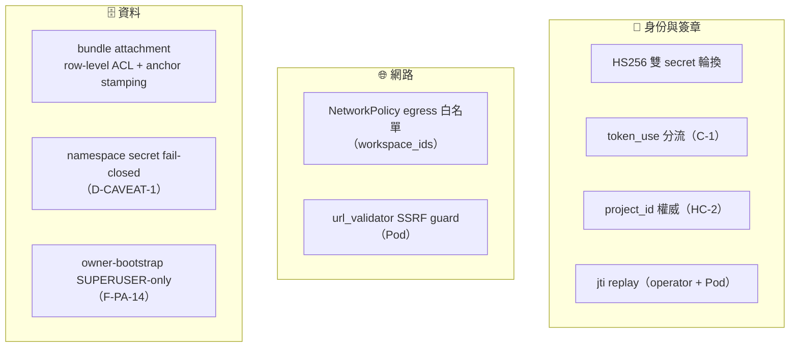
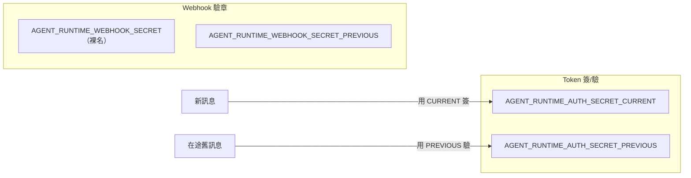
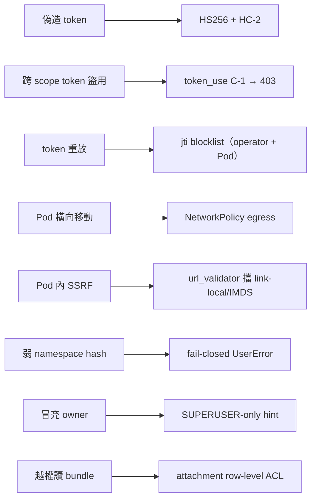

# Skill 系統安全模型

> 把散落各篇的安全機制整合成一張威脅地圖。核心假設：**Pod 是半信任的**——它可能被攻擊者影響，所以每道介面都要能獨立把關。

## 🛡️ 防禦分層

## 🔑 雙 Secret 輪換（簽章與 webhook 各一組）

驗證一律「先 CURRENT、失敗再 PREVIOUS」，所以換 secret 不必同時更新所有 Pod，零停機。

## 🎯 核心防禦原語

| 代號 | 機制 | 防什麼 |
|---|---|---|
| **C-1** | `token_use` 斷言（`ws` ≠ `skill_bundle`） | 拿 ws_token 盜打 `/skill-bundle` → 403 |
| **HC-2** | `project_id` 以 **JWT 為準**，忽略 URL | 改 URL 參數越權讀他人 bundle |
| **jti replay** | operator（`_JTI_SEEN`）+ Pod（`jti_cache`）各一個，TTL 65 分 | 重放擷取到的 token |
| **NetworkPolicy** | egress 白名單 = `workspace_ids` | Pod 橫向打其他 workspace |
| **url_validator** | Pod 建 MCP client 前驗 URL，拒 link-local / IMDS | Pod 內 SSRF |
| **D-CAVEAT-1** | namespace secret **fail-closed** | secret 未設時退化成弱 hash（改為直接 `UserError`） |
| **F-PA-14** | owner-bootstrap hint 僅 SUPERUSER 讀 | 透過 HTTP 注入 context 冒充 owner |
| **attachment ACL** | row-level ACL + anchor stamping | 跨專案讀取 bundle 二進位 payload |

## 🧨 威脅 → 對策

## ⚠️ 跨 repo 部署順序風險（D-CAVEAT-2 / F-PC-7）

`token_use` 的嚴格驗證在 Pod 端（`paas-agent-runtime` 的 F-PC-7，已實作於 `runtime/transport/auth.py`）。**F-PC-7 已 merge main（PR #3）並 build 進發佈 image，stg 已滿足**；但 prod / 新環境仍須遵守 `token_use` deploy-order（**operator 簽 `token_use` 必先於 pod A 嚴格部署**，否則存在 1 小時在途 token 的空窗，D-CAVEAT-2）。狀態追蹤見 [Agent Runtime 演進史 (Phase A~G)](10-roadmap-phases.md)；實際翻 gate 步驟與 prod 上線 gate 見 repo 的 `docs/guides/deployment/agent-runtime-pilot-flip-gate-runbook.md`。

## 🔀 Skill 雙 scope ACL（dual-scope）

Skill 自 `feat/skill-dual-scope` 起分為兩種 scope：`system`（平台策展、`project_id` 為 NULL、全平台共享）與 `user`（綁定 workspace、`project_id` NOT NULL）。雙 scope 改變了原本「純 project_id 隔離」的威脅模型，以下三點為 review 重點。

### (a) ir.rule 拆分（system 唯讀 + user-scope AND-leg）

舊的 `skill_rule_project_admin` / `skill_rule_project_user` / `skill_rule_project_guest` 已於 **migration 18.0.1.0.29** 以 two-DELETE 退役，改為：

- `skill_rule_system_readonly` — domain `[('scope','=','system')]`，對 `base.group_user` **僅 READ**（全平台所有租戶皆可讀 system skill，但不可改）。
- 三條 user-scope rule（`skill_rule_user_admin` / `skill_rule_user_member` / `skill_rule_user_guest`）— 各自 domain **外層帶 `('scope','=','user')` AND-leg**，內層維持 project_id 隔離；AND-leg 確保這些 rule 不會被濫用來建立 / 觸及 `scope='system'` 的 row。
- `skill_rule_admin_full` — `base.group_system` bypass（管理員全權）。

> ⚠️ system skill 對所有租戶可讀是**設計意圖**（平台策展共享），隔離只在 user scope 那一側強制。

### (b) scope-flip 防護是 `write()` guard，不是 ir.rule

ir.rule **無法**阻擋 scope-flip：record rule 的 write 權限檢查評估的是 **pre-write 狀態**，攻擊者把自己 user skill 的 `scope` 翻成 `system`（或清掉 `project_id`）時，rule 看到的仍是改動前合法的 user row，會放行，flip 落地後才變寬 scope，已太遲。

因此改在 model `write()` override 內加 guard：非 superuser 且非 `base.group_system` 的使用者，若試圖變更 `scope` 或 `project_id` → 直接 raise `AccessError`。

> 詳見 [`scope-flip-write-guard-not-ir-rule.md`](../../decisions/patterns/scope-flip-write-guard-not-ir-rule.md)。

### (c) HC-2 放寬：system skill 對任何有效 token 可下載

skill-bundle 下載端點改為 **dual-leg** domain：`state=published AND name AND version AND ('|', project_id==token.project_id, scope='system')`。

- **project-owned leg** 維持 HC-2：以 token 的 `project_id` 為權威（不信任 client 傳入值）。
- **system leg** 刻意放寬：`scope='system'` 的 skill 可被**任一有效 skill_bundle token** 下載（平台策展、全域可取，為設計意圖）。
- (name,version) 衝突時 **project row 遮蔽（shadow）system row**，避免 pod `_TOOL_CACHE` name clash。

## 📚 本 repo 對應 pattern（`docs/decisions/patterns/`）

- `scope-flip-write-guard-not-ir-rule.md` — scope/tenancy flip 的不可變必須靠 `write()` guard（見 dual-scope (b)）
- `constraint-input-trust-expansion.md` — 對應 HC-2（輸入信任邊界）
- `attachment-row-level-acl-and-anchor-stamping.md` — bundle 附件兩層防護
- `credential-claim-test-fixture-coupling.md` — credential 硬化後 test fixture 的連動紀律

## 📁 相關文件

- [PaaS Skill 系統總覽](README.md)
- [Skill Bundle 與 JWT 認證](04-skill-bundle-jwt.md) — 下載端點驗證
- [Webhook 回呼與 ws_token](08-webhook-ws-token.md) — 回呼簽章
- [agent-runtime Pod 內部](06-pod-internals.md) — Pod 端 auth / jti / url_validator
- [Agent Runtime Pod 部署機制](07-deployment.md) · [Skill 設計與發布](03-skill-design.md) · [PaaS Skill 術語表](11-glossary.md)
