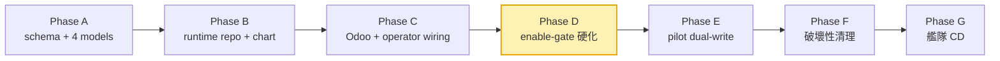

# Agent Runtime 演進史 (Phase A~G)

> 這套系統不是一次蓋好的，而是分 7 個 phase 漸進推進，並刻意用 enable-gate 讓功能「先到位、後開啟」。對應計畫：`docs/plans/2026-Q2/agent-runtime-pod-plan.md`。

## 🗺️ 時間軸

## 📋 各 Phase 做了什麼

| Phase | 內容 | 狀態 |
|---|---|---|
| **A** | schema M:N 遷移（`cloud_service_id`→`cloud_service_ids`）+ 新增 4 個 model（agent_template / agent_session / skill / project_access）+ 16 條 ACL（**未含後台 view**；skill 後台管理 view 於 `feat/skill-list` 補上，見 `docs/superpowers/specs/2026-05-27-skill-admin-backend-ui-design.md`） | ✅ |
| **B** | 建新 repo `woow-paas-agent-runtime`（runtime image）+ helm chart（`woow-paas-charts/charts/agent-runtime/`）；CI build/push 到 JCR；**不部署** | ✅ |
| **C** | Odoo wiring：skill-bundle 端點 + client/webhook + SSE gateway；operator 端點（spawn/reap/resume/delete）；token 生命週期 | ✅ |
| **D** | enable-gate caveat 修補（F-PC-1~7 / F-PA-14 硬化）+ admin 啟用面 + 跨 repo F-PC-7 | ✅ |
| **E** | pilot + 2~12 週 dual-write；對 pilot cohort 翻 `use_agent_runtime=True`；觀察；逐步 rollout（E0 operator-side production gap 已於 2026-05-27 補齊、operator green） | ✅ **現在** |
| **F** | 破壞性清理：確認無需 rollback 後移除舊路徑程式碼 | ⬜ |
| **G** | 艦隊 production CD + 永久 dual-write 收尾 | ⬜ |

## 📍 目前狀態（2026-05）

- **Phase D 完成；已進入 Phase E**（E0 operator-side production gap 於 2026-05-27 補齊、operator green）。
- 整套 agent-runtime 仍以 **enable-gate 控制**，stg pilot 已翻 gate 驗過真 LLM round-trip（2026-05-27，F-PILOT-10），尚未對一般使用者全面開啟。
- Pod 端 transport/skill/安全鷹架已備；**真 LLM runtime（`langgraph_runtime`）已於 F-PILOT-10 上線並完成 cluster e2e round-trip**——見 [agent-runtime Pod 內部](06-pod-internals.md)。
- **翻 gate 的前置條件 F-PC-7**（Pod 端 `token_use` 嚴格驗證）：**已 merge main（PR #3）並 build 進發佈 image，stg 已滿足**；prod / 新環境仍須遵守 `token_use` deploy-order（先 operator 簽、後 pod A 嚴格，否則 1 小時在途 token 空窗，D-CAVEAT-2）。見 [Skill 系統安全模型](09-security-model.md)。

## 🧠 兩個關鍵策略名詞

- **enable-gate** — 功能先合併到位但用開關關閉，降低「合併即上線」的風險。
- **dual-write** — Phase E 讓新舊路徑並行寫入，比對一致後才正式切換，可隨時回退。

## 📁 相關文件

- [PaaS Skill 系統總覽](README.md)
- [Skill 系統安全模型](09-security-model.md) — F-PC-7 / D-CAVEAT 細節
- [Agent Runtime Pod 部署機制](07-deployment.md)
- repo 內：`docs/plans/2026-Q2/agent-runtime-pod-plan.md`、`docs/guides/deployment/agent-runtime-pilot-flip-gate-runbook.md`
