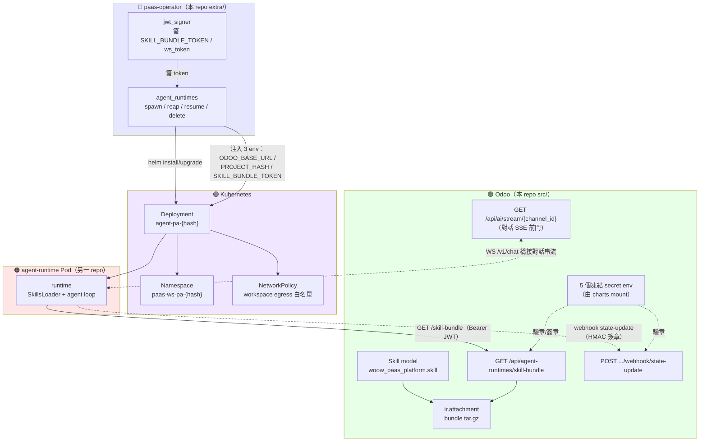

# PaaS Skill 系統總覽

> 入口文件。一頁讀懂「PaaS Skill 系統」(內部代號 agent-runtime-pod) 怎麼運作、由哪些角色組成、該往哪篇深讀。本指南是新人 onboarding 用的知識庫（共 12 篇），閱讀順序見下方「文件地圖」。

> 🧭 **給新人**：不用先懂 K8s / JWT 細節也能讀。建議路線——
> - **快速抓全貌**：本頁 → [Skill 端到端調用流程](01-end-to-end-flow.md) → [Agent 對話與串流](02-conversation-streaming.md)，三篇就夠。
> - **要動手 / 深入**：再按下方文件地圖 03～11 逐篇查。
> - 看到 `F-PC-7`、`HC-2`、`SC-5` 這類代號別慌——那是內部 finding / caveat 編號，定義都在 [PaaS Skill 術語表](11-glossary.md) 的「內部代號速查」。

## 🎯 一句話理解

> **使用者在專案裡觸發一個 Skill → Odoo 透過 paas-operator 在 K8s 開一個 agent-runtime Pod → Pod 拿著一張有時效的 JWT（`SKILL_BUNDLE_TOKEN`）回 Odoo 把該專案的 Skills 抓下來、校驗、解壓、執行。**

用「**雲端外送**」來想：

| 外送 | 對應角色 |
|---|---|
| 點餐的客人 | 🟢 **Odoo**（存 Skill、決定要跑什麼） |
| 外送平台（調度） | 🔵 **paas-operator**（簽憑證、跑 Helm） |
| 廚房 | 🟠 **agent-runtime Pod**（真正執行 Skill） |
| 食譜包 | 📦 **Skill Bundle**（tar.gz） |
| 一次性取餐憑證 | 🔑 **SKILL_BUNDLE_TOKEN**（1 小時效期的 JWT） |

## 🧩 四個角色與所在 repo

| 角色 | 職責 | 位置 |
|---|---|---|
| 🟢 **Odoo** | 存 Skill、發 bundle、收 Pod 回報、橋接對話 | 本 repo `src/` |
| 🔵 **paas-operator** | Odoo↔K8s 中介，簽 token、跑 Helm | 本 repo `extra/paas-operator/` |
| 🟣 **Kubernetes** | 跑 Pod 的基礎設施 | 叢集 |
| 🟠 **agent-runtime Pod** | 載入並執行 Skill、跑 agent loop | **另一 repo** `woow-paas-agent-runtime`（本 repo 只有 contract） |

## 📐 系統架構

> ⚠️ **常見誤解先講清楚**：Pod 啟動時 operator 只注入 **3 個** env（`ODOO_BASE_URL` / `PROJECT_HASH` / `SKILL_BUNDLE_TOKEN`）。那「5 個凍結 secret」是 **Odoo 端**用來簽章／驗章／算 namespace hash 的，由 charts mount，不會進到 Pod。詳見 [Skill 系統安全模型](09-security-model.md)。

## 🔑 核心概念

1. **Skill** — 最小功能單位，一個可執行的外掛（metadata + 程式碼 + 資源）。見 [Skill 設計與發布](03-skill-design.md)
2. **Skill Bundle** — Skill 的封包格式（tar.gz），存在 `ir.attachment`。見 [Skill Bundle 與 JWT 認證](04-skill-bundle-jwt.md)
3. **SKILL_BUNDLE_TOKEN** — operator 簽的 JWT（HS256，1h），Pod 用它向 Odoo 驗證身份並下載 bundle
4. **agent-runtime** — Pod 內負責載入、執行 Skill 與跑對話 agent loop 的 runtime 程序
5. **project hash** — 由 `HMAC-SHA256(project_id, secret)` 取前 10 bytes 做 base32，得 **16 字元小寫**字串，用於命名 namespace / deployment

## 📂 文件地圖（建議閱讀順序）

| # | 文件 | 一句話 | 筆調 |
|---|---|---|---|
| 1 | （本篇）總覽 | 全局地圖 | 深入淺出 |
| 2 | [Skill 端到端調用流程](01-end-to-end-flow.md) | Pod 怎麼被開起來（spawn 主線） | 深入淺出 |
| 3 | [Agent 對話與串流](02-conversation-streaming.md) | 使用者↔LLM 對話怎麼跑、langchain 在哪 | 工程參考 |
| 4 | [Skill 設計與發布](03-skill-design.md) | Skill 是什麼、怎麼包、怎麼發 | 工程參考 |
| 5 | [Skill Bundle 與 JWT 認證](04-skill-bundle-jwt.md) | 封包格式與下載端點的認證 | 工程參考 |
| 6 | [Skill 運行時生命週期](05-skill-runtime-lifecycle.md) | Pod 內如何載入與執行（概念層） | 工程參考 |
| 7 | [agent-runtime Pod 內部](06-pod-internals.md) | Pod 內部實作（WS/auth/skill/langgraph stub） | 工程參考 |
| 8 | [Agent Runtime Pod 部署機制](07-deployment.md) | operator/K8s 如何調度 Pod | 工程參考 |
| 9 | [Webhook 回呼與 ws_token](08-webhook-ws-token.md) | Pod→Odoo 反向通道 + WebSocket 認證 | 工程參考 |
| 10 | [Skill 系統安全模型](09-security-model.md) | 雙 secret / token_use / replay / NetworkPolicy 整合 | 工程參考 |
| 11 | [Agent Runtime 演進史 (Phase A~G)](10-roadmap-phases.md) | 從哪來、現在在哪、往哪去 | 深入淺出 |
| 12 | [PaaS Skill 術語表](11-glossary.md) | 名詞速查 | 參考 |

## 📍 目前進度

Phase D 已完成（branch `feature/agent-pod-phase-d`），系統仍以 **enable-gate 關閉**，尚未對使用者開啟；下一步 Phase E 進 pilot 的 dual-write 觀察期。完整時間軸見 [Agent Runtime 演進史 (Phase A~G)](10-roadmap-phases.md)。

> 🚧 Pod 端的 agent loop（`langgraph_runtime`）目前還是 **Phase B stub**，真正的 langgraph 調用待後續 phase——細節見 [agent-runtime Pod 內部](06-pod-internals.md)。
