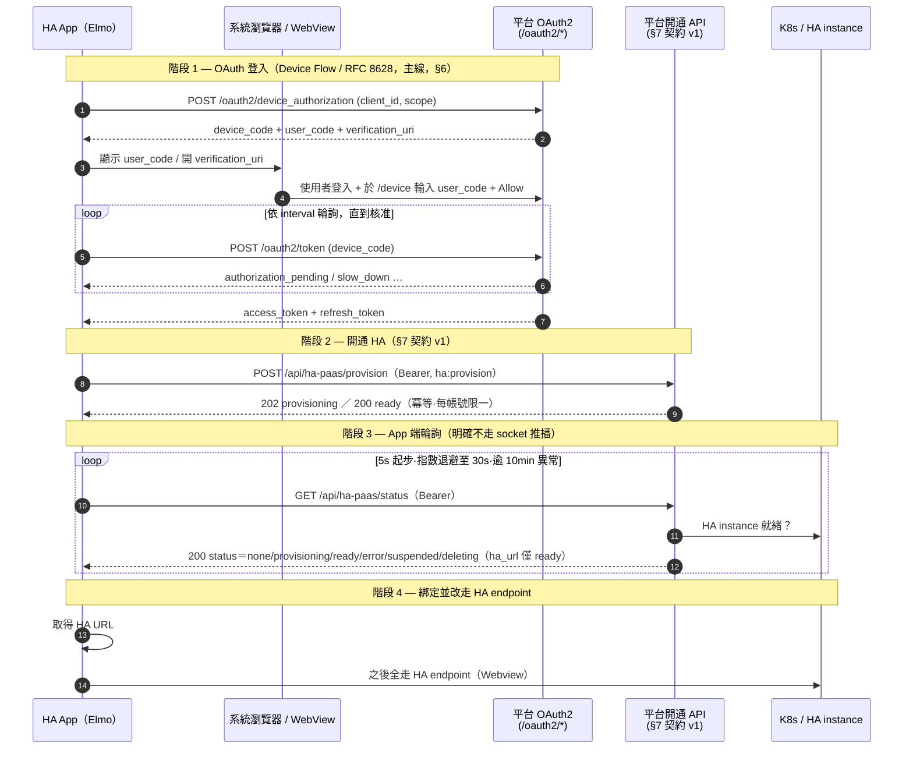

# HA App OAuth 串接與開通包（給 Elmo）

> **文件狀態：OAuth 段與 §7 開通 API 皆已實作並驗活（stg 2026-07-13、prod 2026-07-14）。** 目的是讓 Elmo 拿整包當「HA App AI 開發的輸入 context」（2026-07-10 定價對齊會議決議：把目標＋context 整包丟給 AI 做）。
>
> - **2026-07-12 契約 §7 升 v1.1**：status 枚舉由 4 值擴為 6 值（新增 `suspended`／`deleting` 直映 `cloud_service.state`）；`ha_url` 仍僅 `ready` 給。詳見 §7.3。平台端已隨 [#336](https://git-prod.woowtech.io/odoo-addons/woow_paas_platform/issues/336) 實作完成（`POST /api/ha-paas/provision`＋`GET /api/ha-paas/status`）。
> - **OAuth 段（§1–§6）已可用**：平台早已是自寫的 OAuth 2.0 provider，以下每個技術主張都附 code 出處（`file:line`，2026-09-02 對過 `develop` 重校）。
> - **開通 API 段（§7）＝契約 v1.1，雙方均已實作**：2026-07-12 拍板 contract-first——App 與平台 #336 實作**雙方依 §7 為準**；平台端已落地於 `src/controllers/ha_paas.py`（provision `:158`、status `:220`），Refs [#336](https://git-prod.woowtech.io/odoo-addons/woow_paas_platform/issues/336)。
> - **App client 已 seed 進碼**：`client_id` = **`woow-ha-app`**（xmlid `oauth_client_ha_app`，`src/data/oauth_clients.xml:34-43`）。它是 **public client、沒有 `client_secret`**，故 `client_id` 非機密、比照 `woow-ha-smart-home` 先例明碼 seed；本文件仍**不含**任何 secret（見 §3）。

Refs：[#337](https://git-prod.woowtech.io/odoo-addons/woow_paas_platform/issues/337)（本串接包 task）、[#336](https://git-prod.woowtech.io/odoo-addons/woow_paas_platform/issues/336)（HA PaaS 0 元隱藏訂閱＋開通 API）、[#340](https://git-prod.woowtech.io/odoo-addons/woow_paas_platform/issues/340)（App 專用 public client 建置＋stg device flow 驗證＋憑證交付）。

---

## 0. 讀者與目標

**讀者**：Elmo 與 HA App（手機原生 App）開發團隊。

**HA App 端到端流程**（會議脈絡，2026-07-10）：

```
App OAuth 登入  →  打「開通 HA」API  →  App 端輪詢狀態（明確不走 socket 推播，
HA instance 建立沒那麼快）  →  ready 拿 URL 綁定  →  之後全走 HA endpoint（Webview）
```

本文件把上面第 1 段（OAuth 登入）講到可以直接實作，第 2–4 段（開通 / 輪詢 / 綁定）依 §7 契約 v1.1（平台端已實作，見 `src/controllers/ha_paas.py`）。

### ⚠️ 名詞界定：HA App ≠ HA custom component（很重要，別混）

平台已經有一份 OAuth 串接文件 [`ha-component-integration.md`](ha-component-integration.md)，但它的 consumer 跟本文件**不是同一個東西**，方向相反：

| 對比項 | **HA custom component**（既有） | **HA App**（本文件 / #337） |
| --- | --- | --- |
| 是什麼 | 安裝在**使用者已有的 HA instance 內**的 Python component（`woow_paas_smart_home`） | Elmo 開發的**手機原生 App** |
| 誰連誰 | HA instance → 回連平台，讀既有 SH/SA 服務資料 | App → 平台，**開通一個新的 HA instance** |
| OAuth client | `woow-ha-smart-home`（seed，`client_id` 硬編在 component `const.py`） | **`woow-ha-app`**（seed `oauth_client_ha_app`，`oauth_clients.xml:34-43`；[#340](https://git-prod.woowtech.io/odoo-addons/woow_paas_platform/issues/340) 已交付，見 §3、§9 風險 1） |
| redirect 比對 | `ha_callback` mode（scheme∈{http,https}、path 固定） | **device flow 主線下 App 不做 redirect**（2026-07-12 拍板；見 §9 風險 3） |

**不要複用 `woow-ha-smart-home` 這個 client 給 App。** 原因見 §9。

---

## 給 Elmo 的開發順序建議（兩段式）

拍板（2026-07-12）：授權主線走 **device flow（§6）**。以下兩階段的平台端前置**皆已完成**（#336／#340 皆已關），Elmo 可直接兩段並行：

- **階段 A — OAuth 打通**：
  1. 使用 App 專用 `client_id` = **`woow-ha-app`**（public client、無 secret；[#340](https://git-prod.woowtech.io/odoo-addons/woow_paas_platform/issues/340) 已交付）。
  2. 照 **§6** 接 device flow，先用**既有 read scopes**（如 `workspace:read`、`smarthome:read`）**驗通登入取 token**——這條路現況即可跑，不需等開通 API。
  3. 以取得的 token 呼叫既有讀取端點，確認 OAuth 端到端打通。
- **階段 B — 開通串接**（契約 v1.1）：照 **§7** 實作開通（`POST /api/ha-paas/provision`）＋狀態輪詢（`GET /api/ha-paas/status`）＋ ready 拿 URL 綁定（見 §8 階段 2–4）；平台 #336 已完成，stg／prod 端點皆已驗活（見 §9）。

**平台端前置已全數完成**（[#340](https://git-prod.woowtech.io/odoo-addons/woow_paas_platform/issues/340)：client 建置＋stg device flow 驗證＋憑證交付，2026-07-14 關單）：prod base URL = `https://paas.woowtech.io`。

---

## 1. 平台 OAuth 2.0 能力總覽

平台是**自寫**的 OAuth 2.0 provider（非 Odoo 內建），實作在 `src/controllers/oauth2.py`，類別 `OAuth2Controller`（`src/controllers/oauth2.py:147`）。

### 1.1 支援的 grant types

`/oauth2/token` 的 dispatch 在 `src/controllers/oauth2.py:464-491`：

| grant_type | 支援 | 用途 | 實作 |
| --- | --- | --- | --- |
| `authorization_code` | ✅ | 標準授權碼流程；**支援 PKCE**（S256 / plain） | `_handle_authorization_code`（`oauth2.py:592`） |
| `refresh_token` | ✅ | 換發新 access token，**帶 rotation**（舊 token 立即撤銷） | `_handle_refresh_token`（`oauth2.py:675`） |
| `client_credentials` | ✅ | 機器對機器（無使用者情境，用 SUPERUSER 身分） | `_handle_client_credentials`（`oauth2.py:716`） |
| `urn:ietf:params:oauth:grant-type:device_code` | ✅ | RFC 8628 裝置授權碼＋輪詢 | `_handle_device_code`（`oauth2.py:753`） |

> **給 App 的建議**（2026-07-12 拍板）：HA App 授權主線走 **Device Authorization Grant（RFC 8628）**，見 §6——依自家先例（`woow_paas_smart_home` component 的 Companion App WebView 登入已用 device flow；現有 HA client 也已加此 grant，`oauth_clients.xml:21`）。**Authorization Code + PKCE**（RFC 8252，見 §5）為替代方案。App 專用 client（`woow-ha-app`）建置與 stg／prod 驗證已完成（[#340](https://git-prod.woowtech.io/odoo-addons/woow_paas_platform/issues/340)）。

### 1.2 PKCE

- S256 驗證邏輯：`base64url(sha256(code_verifier))` 去 padding 後與 `code_challenge` 比對（`src/controllers/oauth2.py:76-94`）。
- **public client 一律強制 PKCE 且只收 S256**（缺 `code_challenge` 或 method≠S256 在 authorize 階段即拒：`oauth2.py:199-222`；token 階段再擋一次 downgrade：`oauth2.py:624-663`）。

---

## 2. Endpoints 一覽

所有路徑相對於平台 base URL（`web.base.url`，實際 stg / prod 網域由 ops 提供）。

| 端點 | Method | auth | 用途 | 出處 |
| --- | --- | --- | --- | --- |
| `/oauth2/authorize` | GET | user（需先登入 Odoo session） | 顯示授權同意頁 | `oauth2.py:152` |
| `/oauth2/authorize` | POST | user | 處理 Allow / Deny，簽發 authorization code | `oauth2.py:259` |
| `/oauth2/device_authorization` | POST | none | RFC 8628 §3.1–3.2：簽發 `device_code` + `user_code` | `oauth2.py:342` |
| `/device` | GET / POST | user | RFC 8628 §3.3：使用者輸入 `user_code` 的驗證頁 | `oauth2.py:396` / `oauth2.py:404` |
| `/oauth2/token` | POST | none | 換發 token（上表 4 種 grant） | `oauth2.py:464` |
| `/oauth2/introspect` | POST | none | RFC 7662 token 內省（需 client 認證） | `oauth2.py:808` |
| `/oauth2/revoke` | POST | none | RFC 7009 token 撤銷 | `oauth2.py:856` |

> 其它平台 controller 若要以 Bearer token 保護自家 API，可呼叫 helper `verify_oauth_token(req, required_scopes=[...])`（`oauth2.py:97`）——**#336 的開通 API 就是用這支做鑑權**（`ha_paas.py:14` import、`:32` 呼叫）。

---

## 3. OAuth client 註冊與憑證發放機制

### 3.1 Client 資料模型

Client 存在 Odoo model `woow_paas_platform.oauth_client`（`src/models/oauth_client.py:10`）。關鍵欄位：

| 欄位 | 說明 | 出處 |
| --- | --- | --- |
| `client_id` | public identifier，預設 `secrets.token_urlsafe(32)`，**readonly**（整合方會硬編此值，旋轉會破壞串接） | `oauth_client.py:26-35` |
| `client_type` | `confidential` / `public`（native app 應為 **public**） | `oauth_client.py:41` |
| `client_secret_hash` | 只存 hash；plain secret 僅建立時顯示一次；**public client 必須為空** | `oauth_client.py:36-40`、`oauth_client.py:149-156` |
| `require_pkce` | public client 一律 True（`_check_client_type_consistency` 強制） | `oauth_client.py:53`、`oauth_client.py:109-133` |
| `redirect_uris` | 允許的 redirect URI，一行一個 | `oauth_client.py:60` |
| `redirect_uri_match_mode` | `exact`（逐字比對）/ `ha_callback`（host-flexible，僅 HA component 用） | `oauth_client.py:68` |
| `scopes` | 空白分隔的允許 scope 清單 | `oauth_client.py:84` |
| `grant_types` | 逗號分隔的允許 grant 清單 | `oauth_client.py:89` |
| `is_active` | 停用即拒發 token | `oauth_client.py:95` |

### 3.2 註冊方式（目前）

- **後台 model 管理，無自助註冊 API**：Odoo 後台選單 **Woow PaaS → OAuth Clients**（`src/views/oauth_client_views.xml:85`）由 ops 建立與維護。
- **憑證發放**：
  - **public client（App 建議）**：**沒有 client_secret**，只有 `client_id`。持有證明由 PKCE 的 `code_verifier` 提供（`oauth2.py:517-524`：public client 若在 token 端帶 secret 會被直接拒）。
  - confidential client：後台 form 有「Regenerate Secret」按鈕，secret 一次性彈窗顯示、之後只存 hash（`oauth_client.py:402-420`；該按鈕對 public client 隱藏：`oauth_client_views.xml:32`）。
- **兩個 seed 的 public client**（皆明碼進碼、`client_id` 非機密）：
  - `woow-ha-smart-home`——HA custom component 用，`ha_callback` redirect mode + PKCE，見 `src/data/oauth_clients.xml:14-24`。**不是**給 App 用的。
  - **`woow-ha-app`——本文件的 HA App 用**（xmlid `oauth_client_ha_app`），device flow + refresh token，scopes `workspace:read smarthome:read ha:provision`，見 `src/data/oauth_clients.xml:34-43`、§9 風險 1 的欄位表。

> 🔐 **`client_secret` 絕不進版控 / 不寫進本文件。** 分清楚兩者：`client_id` 是 OAuth 規格上的 **public identifier**（RFC 6749 §2.2），public client 本就沒有 secret，所以 `woow-ha-app` 明碼 seed 進碼、也寫在本文件裡；只有 confidential client 的一次性 `client_secret` 屬機密，由 ops 循安全管道交付、絕不落地在 repo 或本文件。

---

## 4. Scopes

平台目前定義的 scope 共 **6 個**，語意在模組級 `SCOPE_DESCRIPTIONS`（`src/controllers/oauth2.py:29-39`，授權同意頁與 `/device` 頁共用），各 seed client 的 `scopes` 欄位見 `oauth_clients.xml:22`（component）與 `:42`（App）：

| Scope | 授權範圍 |
| --- | --- |
| `workspace:read` | 列舉使用者可存取的 workspace |
| `smarthome:read` | 讀取 Smart Home 清單 / detail / 狀態 |
| `smarthome:tunnel` | 取得 Smart Home 的 tunnel token（高權限） |
| `security-access:read` | 讀取 Security Access 清單 / detail / 狀態 |
| `security-access:tunnel` | 取得 Security Access 的 tunnel token（高權限） |
| `ha:provision` | **寫入**：開通 / 管理使用者的雲端 HA instance（App 主流程唯一必要，見 §7） |

> ⚠️ **`ha:provision` 已實作上線。** 上表**前 5 個** scope 全是「讀取既有服務」；只有 `ha:provision` 是**寫入 / 佈建**。實作已隨 [#336](https://git-prod.woowtech.io/odoo-addons/woow_paas_platform/issues/336) 落地——seed 在 `oauth_clients.xml:42`、既有 DB 靠冪等 healer `_ensure_ha_app_provision_scope`（`oauth_client.py:318`）補；`woow-ha-app` client 已掛上此 scope（[#340](https://git-prod.woowtech.io/odoo-addons/woow_paas_platform/issues/340) 已關）。見 §7、§9 風險 2。
>
> scope 若要新增，seed 是 `noupdate="1"`（`oauth_clients.xml:5`），既有 DB 須靠 idempotent healer 覆蓋升級，不能只改 XML。現有兩支先例：`_ensure_ha_smart_home_sa_scopes`（`oauth_client.py:290` + `oauth_scope_updates.xml`）與 `_ensure_ha_app_provision_scope`（`oauth_client.py:318` + `oauth_ha_provision_scope_update.xml`），兩者皆從 `post_init_hook`（`hooks.py:242`，新裝）與 `<function>`（每次 `-u`，升級）兩處呼叫。

---

## 5. 授權流程（替代方案）：Authorization Code + PKCE

Token 生命週期（`src/controllers/oauth2.py:19-21`）：

| Token | TTL | 出處 |
| --- | --- | --- |
| access token | **1 小時** | `oauth2.py:19` |
| refresh token | **30 天**（換發時 rotation，舊的立即 revoke：`oauth2.py:705-714`） | `oauth2.py:20` |
| authorization code | **10 分鐘**，一次性（`oauth_code.py:70-73`） | `oauth2.py:21` |

### 5.1 步驟

1. App 產生 `code_verifier`（43–128 字隨機），計算 `code_challenge = base64url(sha256(code_verifier))`（去 padding）。
2. App 用系統瀏覽器 / WebView（iOS `ASWebAuthenticationSession`、Android Custom Tabs）開啟授權頁：

   ```
   GET https://<平台網域>/oauth2/authorize
       ?response_type=code
       &client_id=<APP_CLIENT_ID>
       &redirect_uri=<APP_REDIRECT_URI>
       &scope=workspace:read%20smarthome:read
       &state=<隨機_CSRF>
       &code_challenge=<CHALLENGE>
       &code_challenge_method=S256
   ```

   使用者在此登入平台（`auth='user'`）並於同意頁按 Allow。

3. 平台 302 導回：`<APP_REDIRECT_URI>?code=<CODE>&state=<CSRF>`（`oauth2.py:312-338`）。App 先核對 `state`。

4. App 以授權碼換 token（**public client 不帶 client_secret**）：

   ```bash
   curl -X POST https://<平台網域>/oauth2/token \
     -d grant_type=authorization_code \
     -d code=<CODE> \
     -d redirect_uri=<APP_REDIRECT_URI> \
     -d client_id=<APP_CLIENT_ID> \
     -d code_verifier=<VERIFIER>
   ```

   回應（`oauth2.py:576-583`）：

   ```json
   {
     "access_token": "…",
     "token_type": "bearer",
     "expires_in": 3600,
     "scope": "workspace:read smarthome:read",
     "refresh_token": "…"
   }
   ```

5. 之後呼叫平台 API 帶 `Authorization: Bearer <access_token>`。access token 過期時以 refresh token 換發：

   ```bash
   curl -X POST https://<平台網域>/oauth2/token \
     -d grant_type=refresh_token \
     -d refresh_token=<REFRESH_TOKEN> \
     -d client_id=<APP_CLIENT_ID>
   ```

---

## 6. 授權流程（**App 建議主線**）：Device Authorization Grant（RFC 8628）

**為什麼是主線 — 自家先例**：`woow_paas_smart_home` HA component 的 Companion App WebView 登入路徑**已採 device flow**（跨 repo 出處：component repo `ha-components/woow_paas_smart_home` 的 `config_flow.py:127-128`、`:178-291`）。該路徑**無 PKCE**——安全性由 `device_code` 綁定＋瀏覽器端登入同意承擔（使用者必須在 `/device` 頁以 Odoo session 登入並按 Allow 才核發 token）。HA App 沿用同一模式：App 端**不需處理 redirect callback / custom scheme**（見 §9 風險 3）。2026-07-12 拍板以此為主線，前置建置見 [#340](https://git-prod.woowtech.io/odoo-addons/woow_paas_platform/issues/340)。

參數：`device_code` 存活 **15 分鐘**、預設輪詢間隔 **5 秒**（`src/models/oauth_device_code.py:7-8`）。

1. App 取得 device / user code：

   ```bash
   curl -X POST https://<平台網域>/oauth2/device_authorization \
     -d client_id=<APP_CLIENT_ID> \
     -d scope=workspace:read
   ```

   回應（`oauth2.py:387-394`）含 `device_code`、`user_code`、`verification_uri`、`verification_uri_complete`、`expires_in`、`interval`。

2. App 顯示 `user_code` 與 `verification_uri`（可做成 QR），使用者到 `/device` 登入並輸入 `user_code`、按 Allow（`oauth2.py:396-460`）。

3. App 依 `interval` 秒輪詢 `/oauth2/token`：

   ```bash
   curl -X POST https://<平台網域>/oauth2/token \
     -d grant_type=urn:ietf:params:oauth:grant-type:device_code \
     -d device_code=<DEVICE_CODE> \
     -d client_id=<APP_CLIENT_ID>
   ```

   狀態機（`oauth2.py:786-795`）：`authorization_pending`（續等）/ `slow_down`（放慢，interval +5）/ `access_denied` / `expired_token`；核准後回與 §5 步驟 4 相同的 token JSON。

> **注意**：這裡的輪詢是 **OAuth token 輪詢**（等使用者授權完成），與 §0 流程圖階段 3 的「**開通狀態**輪詢」（等 HA instance 建好）是**兩個不同的輪詢**，別混。

---

## 7. 開通 API（契約 v1.1 — App 與 #336 實作雙方依此為準）

> ✅ **契約 v1.1（2026-07-12 拍板 contract-first；同日 status 枚舉擴為 6 值）。** Elmo 的 App 照本節實作、平台 #336 照本節實作。任何變更需**雙向知會並更新本節**（本節即 single source of truth）。平台端實作已完成並驗活（Refs [#336](https://git-prod.woowtech.io/odoo-addons/woow_paas_platform/issues/336)；程式碼 `src/controllers/ha_paas.py`）。

所有路徑相對於平台 base URL（實際 stg / prod 網域由 ops 提供）。鑑權一律帶 `Authorization: Bearer <access_token>`（token 取得見 §6 device flow 主線 / §5 替代），所需 scope 見 §7.1。

### 7.1 Scope

| Scope | 用途 | 狀態 |
| --- | --- | --- |
| `ha:provision` | 開通 HA instance（App 主流程**唯一必要** scope） | **已上線**：seed `oauth_clients.xml:42`＋healer `oauth_client.py:318`（#336）；`woow-ha-app` 已掛上（#340 已關） |

### 7.2 `POST /api/ha-paas/provision` — 觸發開通

- **出處**：`src/controllers/ha_paas.py:158`。
- **Auth**：`Authorization: Bearer <access_token>`（scope：`ha:provision`）。
- **語意**：**冪等、每帳號限一**——已存在則回現況、不重複建。
- **回應**：
  - `202 {"status": "provisioning"}` — 首次觸發，開通進行中。
  - `200 {"status": "ready", "ha_url": "https://…"}` — 已就緒（重複呼叫或已開通完成）。
  - `409 {"status": "suspended", "error": …}` — 服務已停用（蓄意 suspend），不自動 resume；App 引導使用者聯繫支援。
  - `409 {"status": "deleting", "error": …}` — 前一個 instance 正在刪除中，不復活；App 稍後可重新 POST 開通。
- **重試**：`status=error` 時（由 §7.3 status 端點得知）可**再次 POST** 重試佈建（平台鎖內翻 `error→pending` 並重新觸發部署）。
- **錯誤**：`401` = token 無效；`403` = scope 不足（缺 `ha:provision`）。

### 7.3 `GET /api/ha-paas/status` — 查開通狀態（輪詢用）

- **出處**：`src/controllers/ha_paas.py:220`。
- **Auth**：同 §7.2（`Bearer` token，scope `ha:provision`）。
- **回應**：`200 {"status": "none"|"provisioning"|"ready"|"error"|"suspended"|"deleting", "ha_url": …, "error": …}`
  - `status`（**v1.1 6 值**）：`none`（尚未開通）／`provisioning`（建置中）／`ready`（就緒）／`error`（佈建失敗）／`suspended`（服務已停用，直映平台 `cloud_service.state`）／`deleting`（刪除中，直映平台 `cloud_service.state`）。
  - `ha_url`：**僅 `ready` 時給**。
  - `error`：**僅 `error` 時給**。
  - **App 指引**：`suspended` → 顯示「服務已暫停，請聯繫支援」；`deleting` → 顯示「刪除中，稍後可重新開通」，稍後再輪詢／重試 provision。

### 7.4 輪詢建議

- **5 秒起步**，**指數退避至 30 秒**。
- **逾 10 分鐘**視為異常 → 引導使用者重試或聯繫支援。

### 7.5 App 端須知

- **App 不需知道 workspace 概念**：隱藏 workspace／訂閱掛載（0 元「HA PaaS」訂閱、不出現在前台 Cloud Service 列表）全由平台處理（#336 背景）。
- 端到端串接次序見 §8 sequence diagram 階段 2–4。

---

## 8. HA 開通串接全流程（sequence diagram）

> 四個階段的平台端**皆已實作**：OAuth 段見 §1–§6（`src/controllers/oauth2.py`），開通段依 §7 契約 v1.1（`src/controllers/ha_paas.py`）。stg（2026-07-13）與 prod（2026-07-14）皆已驗活，見 §9。



---

## 9. 風險 / 待辦（考古發現 → 落地結果）

原始內容是 2026-07-11 考古當下判斷「撐不撐得起 HA App 串接」的缺口。**風險 1–3 已於 2026-07-12～07-14 全數解除**（[#336](https://git-prod.woowtech.io/odoo-addons/woow_paas_platform/issues/336) 實作＋[#340](https://git-prod.woowtech.io/odoo-addons/woow_paas_platform/issues/340) 驗證交付，兩張皆已關單）；每條保留原始判斷，並補上實際落地結果與量測出處。風險 4 是現況仍成立的限制。

1. ✅ **已解除 — HA App 專用 OAuth client 已 seed 進碼**（確實沒有複用 `woow-ha-smart-home`）。
   - **原判斷（仍成立）**：既有 `woow-ha-smart-home` 是 `ha_callback` redirect mode（`oauth_clients.xml:19`），`client_id` 硬編在 HA component 的 `const.py`（`oauth_client.py:26-35` 註解），consumer 是「HA instance 內的 component」而非手機 App。
   - **落地方式與原規劃不同**：原本要「ops 後台手建」，最後改由 #336 **直接 seed 進碼**（`client_id` 非機密、self-contained＋healer 冪等；先例＝`woow-ha-smart-home` 亦明碼 seed）。record 在 `src/data/oauth_clients.xml:34-43`：

     | 欄位 | 值 |
     | --- | --- |
     | xmlid | `oauth_client_ha_app` |
     | `client_id` | `woow-ha-app` |
     | `client_type` | `public`（`require_pkce=True`——device flow 不檢查 PKCE，保留 §5 替代路徑時才有用） |
     | `grant_types` | `urn:ietf:params:oauth:grant-type:device_code,refresh_token` |
     | `scopes` | `workspace:read smarthome:read ha:provision` |
     | `redirect_uri_match_mode` | `exact` |
     | `redirect_uris` | `urn:ietf:wg:oauth:2.0:oob` |

   - **`redirect_uris` 的答案（原記為「待 #340 於 stg 驗證」）**：model 欄位**至今仍是 `required=True`**（`oauth_client.py:60`），沒有放寬成可留空；seed 改用 RFC 8252 的 out-of-band URI `urn:ietf:wg:oauth:2.0:oob` 當**佔位值**滿足必填，device flow 全程不觸 redirect 比對。
   - **驗證**：stg 2026-07-13 device flow 端到端全綠（含同意頁 scope 描述、refresh rotation、`/device` 手機版面）；prod 2026-07-14 唯讀煙測——`POST https://paas.woowtech.io/oauth2/device_authorization`（`client_id=woow-ha-app`、`scope=ha:provision`）回 **200**、`GET /api/ha-paas/status` 無 token 回 **401**。兩次紀錄見 [#340](https://git-prod.woowtech.io/odoo-addons/woow_paas_platform/issues/340)。

2. ✅ **已解除 — 開通 scope `ha:provision` 已實作上線。**
   - **原判斷**：現有 5 個 scope 全是「讀取既有 SH/SA」（§4），開通這個寫入動作缺一個 scope。
   - **落地**（#336）：`SCOPE_DESCRIPTIONS` 已含 `ha:provision`（`oauth2.py:29-39`，現共 **6 個**）；seed 在 `oauth_clients.xml:42`。既有 DB 靠冪等 healer `_ensure_ha_app_provision_scope`（`oauth_client.py:318`）補——從 `post_init_hook`（`hooks.py:242`，新裝）與 `oauth_ha_provision_scope_update.xml` 的 `<function>`（每次 `-u`，升級）**兩處**呼叫，覆蓋兩條路徑（seed 是 `noupdate=1`，只改 XML 到不了既有 DB）。

3. ✅ **已繞開 — redirect_uri scheme 限制不影響 App**（2026-07-12 拍板走 §6 device flow；以下保留供考古）
   - `_check_ha_callback_uri` 只接受 `scheme∈{http,https}`（`oauth_client.py:217`），手機 App 常用的 custom scheme（如 `woowha://callback`）會被拒。
   - `exact` mode 是純字串逐字比對（`oauth_client.py:190-193`），custom scheme / universal link 可直接註冊。
   - **現況**：`woow-ha-app` 用 `exact` mode ＋ oob 佔位值（見風險 1），device flow 主線下 redirect 完全不參與流程，此題不觸發。
   - **原待拍板選項（考古）**：若改走 §5 Auth Code 路徑，App 端 redirect 策略可選 custom scheme + `exact` mode／universal link／loopback `http://127.0.0.1`（RFC 8252），並據此決定 client 的 `redirect_uri_match_mode` 與 `redirect_uris`。

4. ⚠️ **仍成立 — 無自助 client 註冊 / 憑證發放 API。**
   - 目前只有 Odoo 後台 model（`oauth_client_views.xml`）由 ops 手動建、憑證一次性顯示。
   - **對 HA App 的影響已消失**（改走 seed 進碼，見風險 1）；但**下一個第三方整合方**若不走 seed 路徑，client 建立與憑證交付仍是人工 ops 流程。本文件一律不含 `client_secret`。

---

## 附錄：token 內省與撤銷

- **內省**（確認 token 是否有效、帶哪些 scope）：`POST /oauth2/introspect`，需 client 認證，回 `active` / `scope` / `client_id` / `username` / `exp` / `sub`（`oauth2.py:808-852`，RFC 7662）。
- **撤銷**（登出 / 換帳號）：`POST /oauth2/revoke`，帶 `token`＋client 認證，一律回 200（`oauth2.py:856-890`，RFC 7009）。
