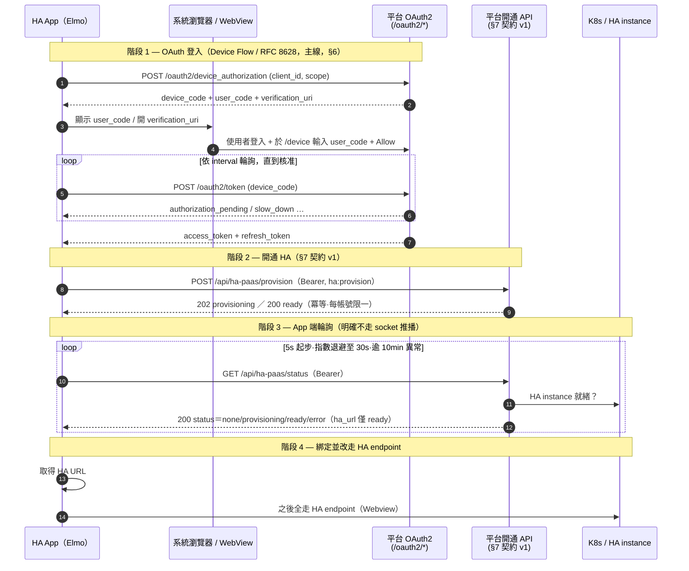

# HA App OAuth 串接與開通包（給 Elmo）

> **文件狀態：OAuth 段可實作、開通契約 v1 已定（contract-first）。** 目的是讓 Elmo 拿整包當「HA App AI 開發的輸入 context」（2026-07-10 定價對齊會議決議：把目標＋context 整包丟給 AI 做）。
>
> - **OAuth 段（§1–§6）已可用**：平台早已是自寫的 OAuth 2.0 provider，以下每個技術主張都附 code 出處（`file:line`），可直接照做。
> - **開通 API 段（§7）是契約 v1**：2026-07-12 拍板 contract-first——App 與平台 #336 實作**雙方依 §7 為準**；平台端實作進度追 [#336](https://git-prod.woowtech.io/odoo-addons/woow_paas_platform/issues/336)。
> - **憑證另發**：本文件**不含**任何真實 `client_id` / `client_secret`；HA App 專用 client 由 ops 註冊後另循安全管道發放（見 §3）。

Refs：[#337](https://git-prod.woowtech.io/odoo-addons/woow_paas_platform/issues/337)（本串接包 task）、[#336](https://git-prod.woowtech.io/odoo-addons/woow_paas_platform/issues/336)（HA PaaS 0 元隱藏訂閱＋開通 API）、[#340](https://git-prod.woowtech.io/odoo-addons/woow_paas_platform/issues/340)（App 專用 public client 建置＋stg device flow 驗證＋憑證交付）。

---

## 0. 讀者與目標

**讀者**：Elmo 與 HA App（手機原生 App）開發團隊。

**HA App 端到端流程**（會議脈絡，2026-07-10）：

```
App OAuth 登入  →  打「開通 HA」API  →  App 端輪詢狀態（明確不走 socket 推播，
HA instance 建立沒那麼快）  →  ready 拿 URL 綁定  →  之後全走 HA endpoint（Webview）
```

本文件把上面第 1 段（OAuth 登入）講到可以直接實作，第 2–4 段（開通 / 輪詢 / 綁定）依 §7 契約 v1（平台端實作追 #336）。

### ⚠️ 名詞界定：HA App ≠ HA custom component（很重要，別混）

平台已經有一份 OAuth 串接文件 [`ha-component-integration.md`](ha-component-integration.md)，但它的 consumer 跟本文件**不是同一個東西**，方向相反：

| 對比項 | **HA custom component**（既有） | **HA App**（本文件 / #337） |
| --- | --- | --- |
| 是什麼 | 安裝在**使用者已有的 HA instance 內**的 Python component（`woow_paas_smart_home`） | Elmo 開發的**手機原生 App** |
| 誰連誰 | HA instance → 回連平台，讀既有 SH/SA 服務資料 | App → 平台，**開通一個新的 HA instance** |
| OAuth client | `woow-ha-smart-home`（seed，`client_id` 硬編在 component `const.py`） | **尚未存在，需 ops 新註冊**（前置 [#340](https://git-prod.woowtech.io/odoo-addons/woow_paas_platform/issues/340)；見 §3、§9 風險 1） |
| redirect 比對 | `ha_callback` mode（scheme∈{http,https}、path 固定） | **device flow 主線下 App 不做 redirect**（2026-07-12 拍板；見 §9 風險 3） |

**不要複用 `woow-ha-smart-home` 這個 client 給 App。** 原因見 §9。

---

## 給 Elmo 的開發順序建議（兩段式）

拍板（2026-07-12）：授權主線走 **device flow（§6）**。建議 Elmo 分兩階段推進，不必等 #336 才動工：

- **階段 A — 現在就能做**（不依賴 #336）：
  1. 等 ops 交付 **App 專用 `client_id`**（前置 [#340](https://git-prod.woowtech.io/odoo-addons/woow_paas_platform/issues/340)）。
  2. 照 **§6** 接 device flow，先用**既有 read scopes**（如 `workspace:read`、`smarthome:read`）**驗通登入取 token**——這條路現況即可跑，不需等開通 API。
  3. 以取得的 token 呼叫既有讀取端點，確認 OAuth 端到端打通。
- **階段 B — 可與平台平行開發**（契約 v1 已定）：照 **§7** 契約 v1 實作開通（`POST /api/ha-paas/provision`）＋狀態輪詢（`GET /api/ha-paas/status`）＋ ready 拿 URL 綁定（見 §8 階段 2–4）；平台 #336 完成後 **stg 聯調**。

**等 ops 交付的前置**：App 專用 `client_id`（[#340](https://git-prod.woowtech.io/odoo-addons/woow_paas_platform/issues/340)：client 建置＋stg device flow 驗證＋憑證交付）。

---

## 1. 平台 OAuth 2.0 能力總覽

平台是**自寫**的 OAuth 2.0 provider（非 Odoo 內建），實作在 `src/controllers/oauth2.py`，類別 `OAuth2Controller`（`src/controllers/oauth2.py:132`）。

### 1.1 支援的 grant types

`/oauth2/token` 的 dispatch 在 `src/controllers/oauth2.py:462-478`：

| grant_type | 支援 | 用途 | 實作 |
| --- | --- | --- | --- |
| `authorization_code` | ✅ | 標準授權碼流程；**支援 PKCE**（S256 / plain） | `_handle_authorization_code`（`oauth2.py:579`） |
| `refresh_token` | ✅ | 換發新 access token，**帶 rotation**（舊 token 立即撤銷） | `_handle_refresh_token`（`oauth2.py:662`） |
| `client_credentials` | ✅ | 機器對機器（無使用者情境，用 SUPERUSER 身分） | `_handle_client_credentials`（`oauth2.py:703`） |
| `urn:ietf:params:oauth:grant-type:device_code` | ✅ | RFC 8628 裝置授權碼＋輪詢 | `_handle_device_code`（`oauth2.py:740`） |

> **給 App 的建議**（2026-07-12 拍板）：HA App 授權主線走 **Device Authorization Grant（RFC 8628）**，見 §6——依自家先例（`woow_paas_smart_home` component 的 Companion App WebView 登入已用 device flow；現有 HA client 也已加此 grant，`oauth_clients.xml:21`）。**Authorization Code + PKCE**（RFC 8252，見 §5）為替代方案。App 專用 client 建置與 stg 驗證見前置 [#340](https://git-prod.woowtech.io/odoo-addons/woow_paas_platform/issues/340)。

### 1.2 PKCE

- S256 驗證邏輯：`base64url(sha256(code_verifier))` 去 padding 後與 `code_challenge` 比對（`src/controllers/oauth2.py:61-79`）。
- **public client 一律強制 PKCE 且只收 S256**（缺 `code_challenge` 或 method≠S256 在 authorize 階段即拒：`oauth2.py:184-207`；token 階段再擋一次 downgrade：`oauth2.py:611-650`）。

---

## 2. Endpoints 一覽

所有路徑相對於平台 base URL（`web.base.url`，實際 stg / prod 網域由 ops 提供）。

| 端點 | Method | auth | 用途 | 出處 |
| --- | --- | --- | --- | --- |
| `/oauth2/authorize` | GET | user（需先登入 Odoo session） | 顯示授權同意頁 | `oauth2.py:137` |
| `/oauth2/authorize` | POST | user | 處理 Allow / Deny，簽發 authorization code | `oauth2.py:255` |
| `/oauth2/device_authorization` | POST | none | RFC 8628 §3.1–3.2：簽發 `device_code` + `user_code` | `oauth2.py:338` |
| `/device` | GET / POST | user | RFC 8628 §3.3：使用者輸入 `user_code` 的驗證頁 | `oauth2.py:392` / `oauth2.py:400` |
| `/oauth2/token` | POST | none | 換發 token（上表 4 種 grant） | `oauth2.py:452` |
| `/oauth2/introspect` | POST | none | RFC 7662 token 內省（需 client 認證） | `oauth2.py:795` |
| `/oauth2/revoke` | POST | none | RFC 7009 token 撤銷 | `oauth2.py:843` |

> 其它平台 controller 若要以 Bearer token 保護自家 API，可呼叫 helper `verify_oauth_token(req, required_scopes=[...])`（`oauth2.py:82`）——**#336 的開通 API 預期就是用這支做鑑權**。

---

## 3. OAuth client 註冊與憑證發放機制

### 3.1 Client 資料模型

Client 存在 Odoo model `woow_paas_platform.oauth_client`（`src/models/oauth_client.py:10`）。關鍵欄位：

| 欄位 | 說明 | 出處 |
| --- | --- | --- |
| `client_id` | public identifier，預設 `secrets.token_urlsafe(32)`，**readonly**（整合方會硬編此值，旋轉會破壞串接） | `oauth_client.py:26-35` |
| `client_type` | `confidential` / `public`（native app 應為 **public**） | `oauth_client.py:41` |
| `client_secret_hash` | 只存 hash；plain secret 僅建立時顯示一次；**public client 必須為空** | `oauth_client.py:36-40`、`oauth_client.py:149-156` |
| `require_pkce` | public client 一律 True（`_check_client_type_consistency` 強制） | `oauth_client.py:53`、`oauth_client.py:109-133` |
| `redirect_uris` | 允許的 redirect URI，一行一個 | `oauth_client.py:60` |
| `redirect_uri_match_mode` | `exact`（逐字比對）/ `ha_callback`（host-flexible，僅 HA component 用） | `oauth_client.py:68` |
| `scopes` | 空白分隔的允許 scope 清單 | `oauth_client.py:84` |
| `grant_types` | 逗號分隔的允許 grant 清單 | `oauth_client.py:89` |
| `is_active` | 停用即拒發 token | `oauth_client.py:95` |

### 3.2 註冊方式（目前）

- **後台 model 管理，無自助註冊 API**：Odoo 後台選單 **Woow PaaS → OAuth Clients**（`src/views/oauth_client_views.xml:85`）由 ops 建立與維護。
- **憑證發放**：
  - **public client（App 建議）**：**沒有 client_secret**，只有 `client_id`。持有證明由 PKCE 的 `code_verifier` 提供（`oauth2.py:504-511`：public client 若在 token 端帶 secret 會被直接拒）。
  - confidential client：後台 form 有「Regenerate Secret」按鈕，secret 一次性彈窗顯示、之後只存 hash（`oauth_client.py:381-399`；該按鈕對 public client 隱藏：`oauth_client_views.xml:32`）。
- **seed client 範例**（僅供理解結構，**不是**給 App 用的）：`woow-ha-smart-home`，public + PKCE，見 `src/data/oauth_clients.xml:14-24`。

> 🔐 **憑證絕不進版控 / 不寫進本文件。** App 專用 client 註冊後，`client_id`（及 confidential 情境的一次性 secret）由 ops 循安全管道交付 Elmo。

---

## 4. Scopes

平台目前定義的 scope 共 **5 個**，語意在授權同意頁的 `scope_descriptions`（`src/controllers/oauth2.py:224-233`），seed client 的 `scopes` 欄位見 `oauth_clients.xml:22`：

| Scope | 授權範圍 |
| --- | --- |
| `workspace:read` | 列舉使用者可存取的 workspace |
| `smarthome:read` | 讀取 Smart Home 清單 / detail / 狀態 |
| `smarthome:tunnel` | 取得 Smart Home 的 tunnel token（高權限） |
| `security-access:read` | 讀取 Security Access 清單 / detail / 狀態 |
| `security-access:tunnel` | 取得 Security Access 的 tunnel token（高權限） |

> ⚠️ **開通 scope 已定名 `ha:provision`（§7 契約 v1）。** 上列 5 個現有 scope 全是「讀取既有服務」；HA App 觸發「開通」這個**寫入 / 佈建**動作用新增的 `ha:provision`（App 主流程唯一必要 scope）。實作（seed＋idempotent healer）隨 #336、client 掛上此 scope 隨 #340，見 §7、§9 風險 2。
>
> scope 若要新增，seed 是 `noupdate="1"`（`oauth_clients.xml:5`），既有 DB 須靠 idempotent healer（如現有的 `_ensure_ha_smart_home_sa_scopes`，`oauth_client.py:290` + `oauth_scope_updates.xml`）覆蓋升級，不能只改 XML。

---

## 5. 授權流程（替代方案）：Authorization Code + PKCE

Token 生命週期（`src/controllers/oauth2.py:19-21`）：

| Token | TTL | 出處 |
| --- | --- | --- |
| access token | **1 小時** | `oauth2.py:19` |
| refresh token | **30 天**（換發時 rotation，舊的立即 revoke：`oauth2.py:692-693`） | `oauth2.py:20` |
| authorization code | **10 分鐘**，一次性（`oauth_code.py:70-73`） | `oauth2.py:21` |

### 5.1 步驟

1. App 產生 `code_verifier`（43–128 字隨機），計算 `code_challenge = base64url(sha256(code_verifier))`（去 padding）。
2. App 用系統瀏覽器 / WebView（iOS `ASWebAuthenticationSession`、Android Custom Tabs）開啟授權頁：

   ```
   GET https://<平台網域>/oauth2/authorize
       ?response_type=code
       &client_id=<APP_CLIENT_ID>
       &redirect_uri=<APP_REDIRECT_URI>
       &scope=workspace:read%20smarthome:read
       &state=<隨機_CSRF>
       &code_challenge=<CHALLENGE>
       &code_challenge_method=S256
   ```

   使用者在此登入平台（`auth='user'`）並於同意頁按 Allow。

3. 平台 302 導回：`<APP_REDIRECT_URI>?code=<CODE>&state=<CSRF>`（`oauth2.py:308-334`）。App 先核對 `state`。

4. App 以授權碼換 token（**public client 不帶 client_secret**）：

   ```bash
   curl -X POST https://<平台網域>/oauth2/token \
     -d grant_type=authorization_code \
     -d code=<CODE> \
     -d redirect_uri=<APP_REDIRECT_URI> \
     -d client_id=<APP_CLIENT_ID> \
     -d code_verifier=<VERIFIER>
   ```

   回應（`oauth2.py:563-577`）：

   ```json
   {
     "access_token": "…",
     "token_type": "bearer",
     "expires_in": 3600,
     "scope": "workspace:read smarthome:read",
     "refresh_token": "…"
   }
   ```

5. 之後呼叫平台 API 帶 `Authorization: Bearer <access_token>`。access token 過期時以 refresh token 換發：

   ```bash
   curl -X POST https://<平台網域>/oauth2/token \
     -d grant_type=refresh_token \
     -d refresh_token=<REFRESH_TOKEN> \
     -d client_id=<APP_CLIENT_ID>
   ```

---

## 6. 授權流程（**App 建議主線**）：Device Authorization Grant（RFC 8628）

**為什麼是主線 — 自家先例**：`woow_paas_smart_home` HA component 的 Companion App WebView 登入路徑**已採 device flow**（跨 repo 出處：component repo `ha-components/woow_paas_smart_home` 的 `config_flow.py:127-128`、`:178-291`）。該路徑**無 PKCE**——安全性由 `device_code` 綁定＋瀏覽器端登入同意承擔（使用者必須在 `/device` 頁以 Odoo session 登入並按 Allow 才核發 token）。HA App 沿用同一模式：App 端**不需處理 redirect callback / custom scheme**（見 §9 風險 3）。2026-07-12 拍板以此為主線，前置建置見 [#340](https://git-prod.woowtech.io/odoo-addons/woow_paas_platform/issues/340)。

參數：`device_code` 存活 **15 分鐘**、預設輪詢間隔 **5 秒**（`src/models/oauth_device_code.py:7-8`）。

1. App 取得 device / user code：

   ```bash
   curl -X POST https://<平台網域>/oauth2/device_authorization \
     -d client_id=<APP_CLIENT_ID> \
     -d scope=workspace:read
   ```

   回應（`oauth2.py:383-390`）含 `device_code`、`user_code`、`verification_uri`、`verification_uri_complete`、`expires_in`、`interval`。

2. App 顯示 `user_code` 與 `verification_uri`（可做成 QR），使用者到 `/device` 登入並輸入 `user_code`、按 Allow（`oauth2.py:400-448`）。

3. App 依 `interval` 秒輪詢 `/oauth2/token`：

   ```bash
   curl -X POST https://<平台網域>/oauth2/token \
     -d grant_type=urn:ietf:params:oauth:grant-type:device_code \
     -d device_code=<DEVICE_CODE> \
     -d client_id=<APP_CLIENT_ID>
   ```

   狀態機（`oauth2.py:773-791`）：`authorization_pending`（續等）/ `slow_down`（放慢，interval +5）/ `access_denied` / `expired_token`；核准後回與 §5 步驟 4 相同的 token JSON。

> **注意**：這裡的輪詢是 **OAuth token 輪詢**（等使用者授權完成），與 §0 流程圖階段 3 的「**開通狀態**輪詢」（等 HA instance 建好）是**兩個不同的輪詢**，別混。

---

## 7. 開通 API（契約 v1 — App 與 #336 實作雙方依此為準）

> ✅ **契約 v1（2026-07-12 拍板 contract-first）。** Elmo 的 App 照本節實作、平台 #336 照本節實作。任何變更需**雙向知會並更新本節**（本節即 single source of truth）。平台端實作進度追 [#336](https://git-prod.woowtech.io/odoo-addons/woow_paas_platform/issues/336)。

所有路徑相對於平台 base URL（實際 stg / prod 網域由 ops 提供）。鑑權一律帶 `Authorization: Bearer <access_token>`（token 取得見 §6 device flow 主線 / §5 替代），所需 scope 見 §7.1。

### 7.1 Scope

| Scope | 用途 | 狀態 |
| --- | --- | --- |
| `ha:provision` | 開通 HA instance（App 主流程**唯一必要** scope） | **新增**；seed＋idempotent healer 隨 #336 實作、client 掛上此 scope 隨 #340 建立 |

### 7.2 `POST /api/ha-paas/provision` — 觸發開通

- **Auth**：`Authorization: Bearer <access_token>`（scope：`ha:provision`）。
- **語意**：**冪等、每帳號限一**——已存在則回現況、不重複建。
- **回應**：
  - `202 {"status": "provisioning"}` — 首次觸發，開通進行中。
  - `200 {"status": "ready", "ha_url": "https://…"}` — 已就緒（重複呼叫或已開通完成）。
- **重試**：`status=error` 時（由 §7.3 status 端點得知）可**再次 POST** 重試佈建。
- **錯誤**：`401` = token 無效；`403` = scope 不足（缺 `ha:provision`）。

### 7.3 `GET /api/ha-paas/status` — 查開通狀態（輪詢用）

- **Auth**：同 §7.2（`Bearer` token，scope `ha:provision`）。
- **回應**：`200 {"status": "none"|"provisioning"|"ready"|"error", "ha_url": …, "error": …}`
  - `status`：`none`（尚未開通）／`provisioning`（建置中）／`ready`（就緒）／`error`（佈建失敗）。
  - `ha_url`：**僅 `ready` 時給**。
  - `error`：**僅 `error` 時給**。

### 7.4 輪詢建議

- **5 秒起步**，**指數退避至 30 秒**。
- **逾 10 分鐘**視為異常 → 引導使用者重試或聯繫支援。

### 7.5 App 端須知

- **App 不需知道 workspace 概念**：隱藏 workspace／訂閱掛載（0 元「HA PaaS」訂閱、不出現在前台 Cloud Service 列表）全由平台處理（#336 背景）。
- 端到端串接次序見 §8 sequence diagram 階段 2–4。

---

## 8. HA 開通串接全流程（sequence diagram）

> 階段 1（OAuth）為現況可實作；階段 2–4 依 §7 契約 v1；平台實作追 #336。



---

## 9. 風險 / 待辦（考古發現 — 給 leader / Eugene）

以下是考古 OAuth 現況後，判斷「撐不撐得起 HA App 串接」的缺口。**本文件只記錄，不自行改 `src/`。**

1. **HA App 需要一個全新的 OAuth client（不可複用 `woow-ha-smart-home`）。**
   - 既有 `woow-ha-smart-home` 是 `ha_callback` redirect mode（`oauth_clients.xml:19`），`client_id` 硬編在 HA component 的 `const.py`（`oauth_client.py:26-35` 註解），consumer 是「HA instance 內的 component」而非手機 App。
   - **前置 [#340](https://git-prod.woowtech.io/odoo-addons/woow_paas_platform/issues/340)（建置）**：由 ops 為 HA App 新註冊一個 public client（`client_type=public`；public client 一律強制 `require_pkce=True`——對 device flow 路徑無影響，device 端不檢查 PKCE，且保留 §5 替代路徑時有用）。
   - **grants**：走 device flow 主線，新 client 的 `grant_types` 需含 `urn:ietf:params:oauth:grant-type:device_code` 與 `refresh_token`（若也保留 §5 替代路徑再加 `authorization_code`）。
   - **redirect_uris**：純 device flow 下 redirect 不參與流程，但 model 的 `redirect_uris` 目前為 `required`（`oauth_client.py:60`），**能否留空／需填佔位值待 #340 於 stg 驗證**。

2. **開通 scope `ha:provision`（契約 v1 已定名）。**
   - 現有 5 個 scope 全是「讀取既有 SH/SA」（§4），開通用的寫入 scope `ha:provision` 已於 §7 契約 v1 定名。
   - **實作追 #336**：新增 `ha:provision` 並在既有 DB 以 idempotent healer 升級（seed 是 `noupdate=1`，改 XML 到不了既有 DB）；healer 需求不變。client 掛上此 scope 隨 #340。

3. **redirect_uri scheme 限制：`ha_callback` mode 拒 custom scheme。**（**2026-07-12 已拍板走 §6 device flow 繞開此題，前置 [#340](https://git-prod.woowtech.io/odoo-addons/woow_paas_platform/issues/340)；以下保留供考古**）
   - `_check_ha_callback_uri` 只接受 `scheme∈{http,https}`（`oauth_client.py:217`），手機 App 常用的 custom scheme（如 `woowha://callback`）會被拒。
   - `exact` mode 是純字串逐字比對（`oauth_client.py:190-193`），custom scheme / universal link 可直接註冊。
   - **原待拍板選項（考古）**：若改走 §5 Auth Code 路徑，App 端 redirect 策略可選 custom scheme + `exact` mode／universal link／loopback `http://127.0.0.1`（RFC 8252），並據此決定新 client 的 `redirect_uri_match_mode` 與 `redirect_uris`。device flow 主線下此題不觸發。

4. **無自助 client 註冊 / 憑證發放 API。**
   - 目前只有 Odoo 後台 model（`oauth_client_views.xml`）由 ops 手動建、憑證一次性顯示。
   - **影響**：HA App client 的建立與憑證交付是**人工 ops 流程**，需納入上線清單；本文件不含真實憑證。

---

## 附錄：token 內省與撤銷

- **內省**（確認 token 是否有效、帶哪些 scope）：`POST /oauth2/introspect`，需 client 認證，回 `active` / `scope` / `client_id` / `username` / `exp` / `sub`（`oauth2.py:795-839`，RFC 7662）。
- **撤銷**（登出 / 換帳號）：`POST /oauth2/revoke`，帶 `token`＋client 認證，一律回 200（`oauth2.py:843-877`，RFC 7009）。
